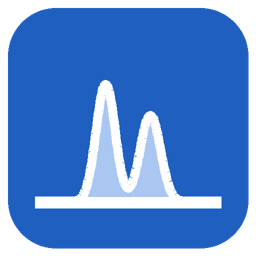

<p align="center"></p>

# PeakForge 锻峰

**XPS 分析桌面软件**：读取 PHI `.spe` / VAMAS `.vms` / CSV / Excel → 荷电校准 → 背景扣除 → 带约束的分峰拟合 → 拟合质量诊断 → 一键导出 Origin 工程（`.opju`）、高分辨率图片和 Excel。
既可以在图形界面里纯手动分析，也可以通过 **MCP** 接入 Claude Code / Codex / Cursor 等 AI Agent，用自然语言指挥分析。

[English README](README_en.md)

## 功能

| 模块 | 内容 |
|---|---|
| 数据读取 | PHI MultiPak/SmartSoft `.spe`（二进制）、VAMAS `.vms`（ISO 14976）、CSV/TXT、Excel；同一测量的 SPE 与 VMS 读出完全一致（统一为 CPS） |
| 荷电校准 | C 1s C–C 自动定位到 284.8 eV（可改参考值），或手动输入位移；按样品保存 |
| 背景 | Shirley、Smart（不超过数据）、线性、Tougaard（U3 通用截面），端点可在图上拖动；自动选端点以避开相邻峰的拖尾 |
| 线形 | Gaussian、Lorentzian、Pseudo-Voigt、GL(积) / SGL(和)（CasaXPS 记法）、Voigt、Doniach–Šunjić⊗Gauss、LA 不对称线形；面积归一 |
| 约束 | 每个参数可设上下限、固定，或用表达式联动（如 `Ir4.fwhm`、`Ir0.center + 1.0`）；自旋轨道双峰（间距、面积比）内置于 51 个常见能级 |
| 预设库 | C 1s 污染碳、O 1s 氧化物、Ir 4f、Ta 4f、Pt 4f、Au 4f 等；可把当前模型保存为自己的预设 |
| 诊断 | 参数顶边界、强相关参数、去掉每个组分重拟合的 ΔBIC（判断组分是否被数据支持）、多起点稳定性、残差 |
| 批量 | 一个样品的模型套用到其它样品（可固定 FWHM/线形参数），堆叠对比图，元素定量（RSF 可编辑） |
| 配色 | 24 套自然景观配色，6 个色族 × 4：水域（冰川 Glacier·峡湾·泻湖·深海）、森林（苔原·松林·竹林·雨林）、大地（沙漠·峡谷·黄土·恶地）、天穹（晨曦·暮色·极光·薄暮）、山岩（玄武·花岗·板岩·高地）、原野（薰衣草田·草甸·秋野·草原）；每套标注类型：单色渐变 / 多色对比 / 柔和期刊 / 色盲友好；可新建自定义配色。默认「冰川 Glacier」即原 Ir-new 模板配色 |
| 导出 | Origin `.opju`（Ir-new 模板版式 + 所选配色）；没有 Origin 时输出数据 + 脚本，在 Origin 中 `run -pyf` 即可生成；PNG/TIFF/SVG/PDF；Excel |
| Agent | `peakforge mcp` 提供 20 个 MCP 工具；GUI 实时显示 Agent 的修改 |

## 安装（Windows）

1. 安装 [Python 3.11 或 3.12](https://www.python.org/downloads/)（勾选 *Add to PATH*）。
2. 点击本页绿色 **Code → Download ZIP**，解压。
3. 双击 `installer.py`，按提示安装（需要联网，约 600 MB）。完成后桌面出现 **PeakForge 锻峰** 图标，`.xpsproj` 工程文件可双击打开。

> 本机有 Origin 2021 以上时，勾选“安装 originpro”即可直接生成 `.opju`。

命令行安装（任意平台）：

```bash
pip install "git+https://github.com/Wiolic/PeakForge.git"
peakforge gui
```

## 快速上手（图形界面）

1. **文件 → 新建工程**，选一个空文件夹。
2. **文件 → 导入数据**，选择 `.spe` / `.vms` / `.csv` / `.xlsx`（原始文件会复制到 `data/raw/` 并设为只读）。
3. **分析 → 自动荷电校准**。
4. 左侧选一个谱区 → 右侧选预设 → **应用** → **拟合**（F5）。
   - 图上：拖动菱形标记移动峰；拖动虚线改背景端点；右键添加/删除峰；滚轮缩放。
   - 参数表：改数值、上下限、勾选“可变”、填“联动表达式”。
5. **拟合诊断**（F6）查看组分是否被数据支持。
6. **分析 → 批量应用当前模型** 套用到其它样品。
7. **导出**（Ctrl+E）：Origin / 图片 / Excel。

## 接入 AI Agent（MCP）

菜单 **Agent → 连接 AI Agent** 会给出可直接复制的配置。以 Claude Code 为例：

```bash
claude mcp add peakforge -- peakforge mcp
```

然后在工程文件夹里对 Agent 说“把所有样品的 Ir 4f 用 Ir⁰/Ir⁴⁺/Ir³⁺ 模型拟合，检查诊断后导出 Origin”。
Agent 的每一步都写进工程文件夹，打开着的 GUI 会自动刷新。菜单里的“写入 AGENTS.md”会给 Agent 留下分析规则。

## 工程文件夹结构

```
MyProject/
  MyProject.xpsproj    工程（样品、荷电位移、设置）
  data/raw/            原始数据（只读）
  models/              每个谱的分峰模型 + 最近一次拟合结果（JSON）
  presets/             本工程专用预设
  output/              所有导出，可随时删除重建
```

## 命令行

```bash
peakforge init D:/xps/proj --name IrTaOx
peakforge add D:/xps/proj data/*.spe
peakforge charge D:/xps/proj
peakforge fit D:/xps/proj --region "Ir 4f" --deep
peakforge export D:/xps/proj --formats png xlsx origin
```

`peakforge --help` 查看全部命令。

## 注意

- 内置 RSF 为 Scofield 截面的近似值，仅供粗略定量；正式定量请在“元素定量”表中改成你所用仪器的 RSF。
- 预设只是起点：报告价态占比前请看诊断（ΔBIC、顶边界、相关性）。

## 许可

MIT © Wiolic
