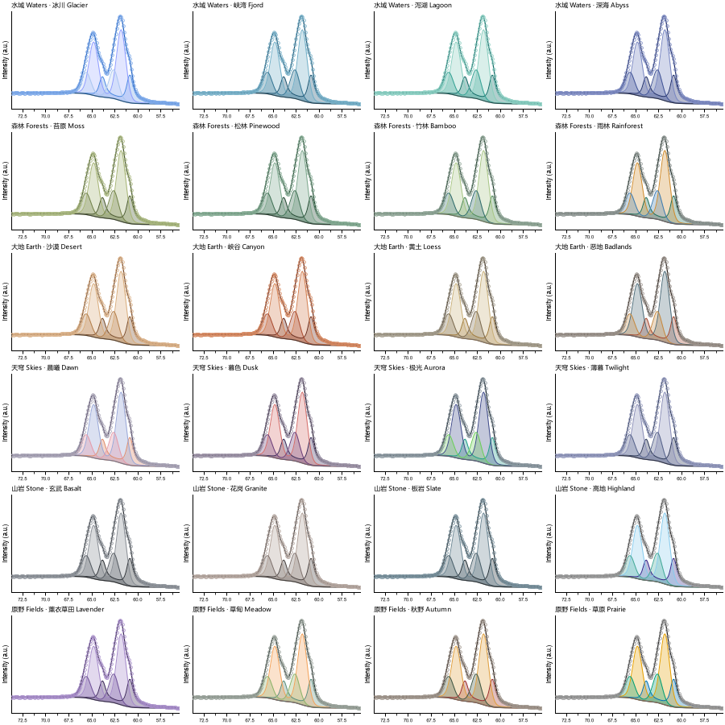

<p align="center"></p>

<h1 align="center">PeakForge</h1>

<p align="center"><b>From raw XPS data to publication-ready Origin figures in minutes.</b><br>
Free · open source · point-and-click · or hand the whole analysis to an AI agent</p>

<p align="center"><b>Developed by Eggy &amp; Claude Opus 5.5</b></p>

<p align="center"><a href="README.md">中文</a> ·
<a href="#why-peakforge">Why</a> ·
<a href="#install-no-programming-needed">Install</a> ·
<a href="#quickstart-a-mouse-only">Quickstart: mouse</a> ·
<a href="#quickstart-b-let-an-ai-do-it">Quickstart: AI</a> ·
<a href="#reading-the-results">Reading results</a> ·
<a href="#disclaimer">Disclaimer</a></p>


## Why PeakForge

A common XPS workflow: fit in the instrument software (Thermo **Avantage**, PHI **MultiPak**), export to Excel/text, rebuild every figure in Origin by hand, repeat for the next sample. PeakForge does it in **one window and a few clicks**.

| | PeakForge | Typical workflow (e.g. Avantage) |
|---|---|---|
| **Cost & licence** | Free, open source (MIT), any Windows PC | Commercial, licensed, often only on the instrument PC |
| **Formats** | PHI `.spe`, VAMAS `.vms`, CSV/TXT, Excel in one place (SPE and VMS of one acquisition read identically) | Vendor software focuses on its own formats |
| **Figures** | **One click → Origin project `.opju`**, one formatted graph per region (data, background, envelope, filled components, legend, labels), still editable in Origin | Export data, rebuild each graph in Origin |
| **Palettes** | 24 systematic palettes (monochrome / contrast / soft / colour-blind safe), identical in app, images and Origin | Set colours by hand |
| **Batch** | Apply a tuned model to all samples in one click (optionally fixing widths/shape) + stacked comparison plots | Usually sample by sample |
| **Elements** | All 90 elements Li–U, 169 core levels with spin–orbit data; any element can start from automatic peak search | Depends on software/version |
| **Trust** | Built-in diagnostics: bound hits, correlated parameters, **ΔBIC when removing each component**, multi-start stability | Usually left to the user |
| **Traceability** | Raw data kept read-only; every model/result stored as readable JSON | Internal files |
| **AI** | MCP interface: describe the analysis in plain language, an agent (Claude, Codex…) runs it; the window shows every step live | — |

**Measured speed** (ordinary laptop): Ir 4f three-state fit with asymmetric line shape 0.5–4 s; a 5-region sample fitted from presets ≈ 3 s; 15 regions exported to a formatted Origin project ≈ 13 s.

**When you still need Avantage / CasaXPS / MultiPak:** for cross-checking before publication (strongly recommended — see the [disclaimer](#disclaimer)), for vendor-specific transmission functions and RSF libraries, and for depth profiles, imaging, ARXPS (not in PeakForge 0.1).


## Install (no programming needed)

1. Install **Python 3.12** from <https://www.python.org/downloads/> — tick **“Add python.exe to PATH”**.
2. On this page: green **Code** button → **Download ZIP**, unzip anywhere.
3. Double-click **`installer.py`** (if it opens in an editor: right-click → *Open with* → *Python*), click **Install**, wait (~600 MB download). Keep “install originpro” ticked if Origin 2021+ is installed.
4. A **PeakForge** icon appears on the desktop; `.xpsproj` project files open with a double-click.

## Quickstart A: mouse only

Practice files: `examples/demo_fresh.csv`, `examples/demo_aged.csv` (synthetic C 1s, O 1s, Ir 4f, Ti 2p).

1. **File → New project**, choose an empty folder.
2. **Import data** — select `.spe` / `.vms` / `.csv` / `.xlsx` files (raw files are copied read-only).
3. **Auto charge correction** (C 1s C–C → 284.8 eV). Right-click a sample to set a shift by hand.
4. Click a region on the left (e.g. `Ir 4f`).
5. In **Preset** pick a preset (C 1s, O 1s, Ir/Ta/Pt/Au 4f) or **“Generic: automatic peak search (any element)”**, click **Apply**.
6. Click **Fit**. The dot turns green; the number is the residual RMS (< 2–3 % is usually good).
7. Adjust if needed: drag the coloured dots (position/height), right-click to add/remove peaks or set background ends, drag the dashed lines, edit values/bounds/“Vary”, link parameters (`Ir4.fwhm`), **Fit** again; `Ctrl+Z` undoes.
8. **Diagnostics** — warnings and ΔBIC per component.
9. **Analysis → Apply model to others** (batch) or **Fit all**.
10. Choose a palette (top right), **Export** → Origin / PNG / Excel. The output folder opens automatically.

Tips: wrong region name (e.g. CSV column “Sample1”)? Right-click it → **Assign element / core level…**. Only 2p3/2 measured? Choose `Fe 2p3/2` — fitted as singlets. Language: **View → Language**.

## Quickstart B: let an AI do it

1. Install the Claude desktop app (<https://claude.ai/download>) and open the **Code** tab (Codex, Cursor and other MCP clients also work).
2. In PeakForge click **Agent** → **Copy** (Claude Code line). In Claude, paste it after: *“Please run this command to connect PeakForge as an MCP tool, then tell me to reopen the session:”*. Allow the command, start a new session.
3. Select your data folder as the working folder and ask, e.g.:

> Use PeakForge on the XPS data in this folder: create a project “IrTaOx”, import all .spe files, charge-correct with C 1s at 284.8 eV and report the shifts, fit Ir 4f with the Ir⁰/Ir⁴⁺/Ir³⁺ preset, O 1s with the oxide preset and everything else with generic automatic peak search, run diagnostics on every Ir 4f and list unsupported components and parameters at bounds, export Origin + PNG + Excel with the “fjord” palette, then summarise the oxidation-state fractions in a table and remind me to cross-check with CasaXPS or Avantage.

The open PeakForge window reloads whenever the agent changes the project, so you can watch, correct by hand, and let the agent continue.

## Reading the results

| Metric | Meaning | Rule of thumb |
|---|---|---|
| Residual RMS (%) | misfit relative to peak height | < 2–3 % good; structured residual = missing component or wrong background |
| χ²ᵣ | residual normalised by noise | ≈ 1 means misfit ≈ counting noise |
| ±1σ | statistical uncertainty | comparable to the value → not determined by the data |
| At bounds | parameter stuck at a limit | constraints are deciding the result |
| \|corr\| > 0.95 | parameters trade off | report them separately with care |
| ΔBIC (component removed) | how much worse without it | > 10 strong, 2–10 positive, < 2 not supported; “local minimum” = refit with more starts |
| Multi-start spread | fractions from different starts | > 3 % → result depends on starting values |

## Palettes

24 landscape palettes in 6 families × 4, each tagged by type; custom palettes can be saved.
Waters: Glacier (default), Fjord, Lagoon, Abyss · Forests: Moss, Pinewood, Bamboo, Rainforest · Earth: Desert, Canyon, Loess, Badlands · Skies: Dawn, Dusk, Aurora, Twilight · Stone: Basalt, Granite, Slate, Highland · Fields: Lavender, Meadow, Autumn, Prairie.



## For programmers

```bash
pip install "git+https://github.com/Wiolic/PeakForge.git"
peakforge gui
peakforge init D:/xps/proj --name IrTaOx && peakforge add D:/xps/proj data/*.spe
peakforge charge D:/xps/proj && peakforge fit D:/xps/proj --region "Ir 4f" --deep
peakforge export D:/xps/proj --formats png xlsx origin --theme fjord
peakforge mcp
```

Tests: `python -m pytest -q` (includes a fit of every one of the 169 core levels). Core-level table: `tools/build_orbitals.py`.

## Disclaimer

PeakForge is a research aid. Fitted results depend on the chosen background, line shapes, constraints and starting values and may be biased. **Before publishing or drawing conclusions, cross-check against established XPS software (e.g. CasaXPS, Thermo Avantage, PHI MultiPak)** and judge the results yourself. The authors accept no liability for any results obtained. Built-in binding energies, splittings and sensitivity factors are approximate handbook values used only to seed fits.

Avantage, MultiPak, CasaXPS and Origin are trademarks of their respective owners; PeakForge is not affiliated with them.

MIT License · **Developed by Eggy & Claude Opus 5.5**
