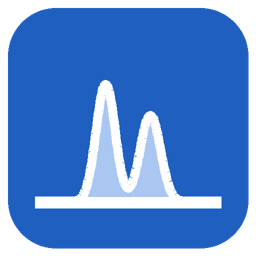
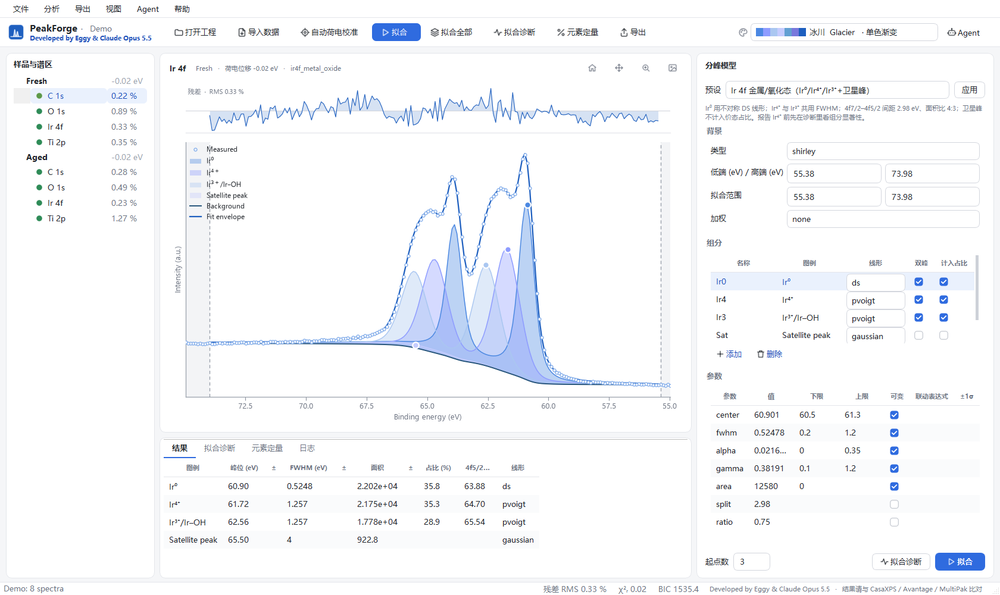
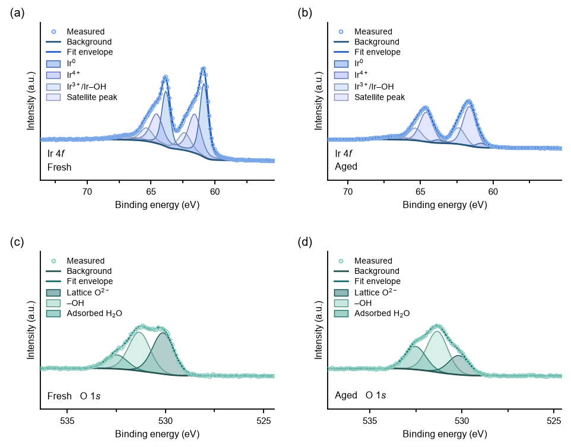
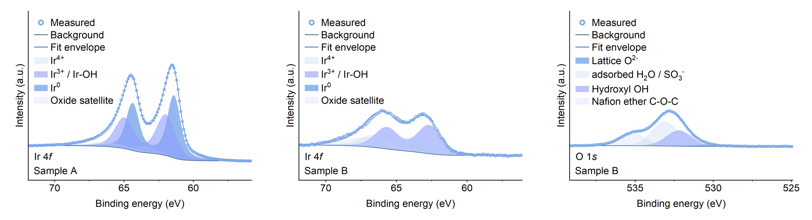

<p align="center"></p>

<h1 align="center">PeakForge</h1>

<p align="center"><b>From raw XPS data to publication-ready Origin figures in minutes.</b><br>
Free · open source · point-and-click · or hand the whole analysis to an AI agent</p>

<p align="center"><b>Developed by Eggy &amp; Claude Opus 5.5</b></p>

<p align="center"><a href="README.md">中文</a> ·
<a href="#why-peakforge">Why</a> ·
<a href="QUICKSTART_en.md"><b>Quickstart</b></a> ·
<a href="#reading-the-results">Reading results</a> ·
<a href="docs/METHODS_en.md">Methods</a> ·
<a href="src/peakforge/docs/GUI_guide_en.md">GUI guide</a> ·
<a href="src/peakforge/docs/fitting_tutorial_en.md">Fitting tutorial</a> ·
<a href="src/peakforge/docs/XPS_basics_en.md">XPS basics</a> ·
<a href="#disclaimer">Disclaimer</a></p>



## Why PeakForge

A common XPS workflow: fit in the instrument software (Thermo **Avantage**, PHI **MultiPak**), export to Excel/text, rebuild every figure in Origin by hand, repeat for the next sample. PeakForge does it in **one window and a few clicks**.

| | PeakForge | Typical workflow (e.g. Avantage) |
|---|---|---|
| **Cost & licence** | Free, open source (MIT), any Windows PC | Commercial, licensed, often only on the instrument PC |
| **Formats** | PHI `.spe`, VAMAS `.vms`, Thermo Avantage `.vgp`/`.VGD`, CSV/TXT, Excel in one place (SPE and VMS of one acquisition read identically) | Vendor software focuses on its own formats |
| **Figures** | **One click → Origin project `.opju`**, one formatted graph per region (data, background, envelope, filled components, legend, labels), still editable in Origin | Export data, rebuild each graph in Origin |
| **Palettes** | One base colour per figure generates its component colours; 8 colour combos assign bases to a whole set of figures (same element, same colour) — identical in app, images and Origin | Set colours by hand |
| **Batch** | Apply a tuned model to all samples in one click (optionally fixing widths/shape) + stacked comparison plots | Usually sample by sample |
| **Elements** | All 90 elements Li–U, 169 core levels with spin–orbit data; any element can start from automatic peak search | Depends on software/version |
| **Trust** | Built-in diagnostics: bound hits, correlated parameters, **ΔBIC when removing each component**, multi-start stability | Usually left to the user |
| **Traceability** | Raw data kept read-only; every model/result stored as readable JSON | Internal files |
| **AI** | MCP interface: describe the analysis in plain language, an agent (Claude, Codex…) runs it; the window shows every step live | — |

**Measured speed** (ordinary laptop): Ir 4f three-state fit with asymmetric line shape 0.5–4 s; a 5-region sample fitted from presets ≈ 3 s; 15 regions exported to a formatted Origin project ≈ 13 s.

**When you still need Avantage / CasaXPS / MultiPak:** for cross-checking before publication (strongly recommended — see the [disclaimer](#disclaimer)), for vendor-specific transmission functions and RSF libraries, and for depth profiles, imaging, ARXPS (not in PeakForge 0.1).

Combined figure generated by PeakForge (`figures/combined.png`) from real measurements of an IrTaOx electrocatalyst (sample names anonymised: A fresh, B after operation); Ir 4f in *Glacier*, O 1s in *Lagoon*; B's Ir⁰ position and line shape fixed to A's fit, B's O 1s includes the Nafion ether peak:



The same fits exported as an Origin project (`.opju`, one editable graph per region):



## Getting started

**No programming background? Read the [Quickstart](QUICKSTART_en.md)** — install, a 10-step mouse-only workflow, and how to hand the analysis to an AI, all without a command line.

**Windows installer (no Python needed)**: download `PeakForge-<version>-Setup.exe` (or the portable zip) from the
[Releases page](https://github.com/Wiolic/PeakForge/releases/latest). It installs for the current user without admin rights.
The installer is not code-signed, so Windows SmartScreen may say "Windows protected your PC": click *More info → Run anyway*;
some antivirus programs also flag unsigned PyInstaller apps — compare the file with `SHA256SUMS.txt` on the Release page.
The packaged app is not yet validated on a clean machine (see `packaging/ACCEPTANCE.md`).

Or from source:

1. Install Python 3.12 (tick *Add python.exe to PATH*) → download this repo as ZIP → double-click `installer.py`.
2. **Mouse**: New project → Import data → Auto charge correction → preset or “Generic: automatic peak search” → Fit → Diagnostics → Export to Origin.
3. **AI**: in PeakForge click **Agent → Connect AI to this folder** → open that folder in the Claude desktop app (Code tab) → describe the task.

## Reading the results

| Metric | Meaning | Rule of thumb |
|---|---|---|
| Residual RMS (%) | misfit relative to peak height | < 2–3 % good; structured residual = missing component or wrong background |
| χ²ᵣ | residual normalised by counting noise (“≈”: noise estimated from the data) | ≈ 1 means misfit ≈ counting noise; high-count spectra are often ≫ 1 even at small RMS — see [methods](docs/METHODS_en.md#4-noise-model-weighting-and-χᵣ-fitpy) |
| ±1σ | statistical uncertainty | comparable to the value → not determined by the data |
| At bounds | parameter stuck at a limit | constraints are deciding the result |
| \|corr\| > 0.95 | parameters trade off | report them separately with care |
| ΔBIC (component removed) | how much worse without it | > 10 strong, 2–10 positive, < 2 not supported; “local minimum” = refit with more starts |
| Multi-start spread | fractions from different starts | > 3 % → result depends on starting values |

## Palettes

Pick **one base colour** per figure (18 evenly spaced hues + graphite + slate); the component colours are generated from it in OKLCH: fixed hue (±15° when there are many components), graded lightness, neighbours alternating dark/light so that they contrast; a single-colour "gradient" mode is available too.

A *combo* (Glacier · Fjord · Rainforest · Desert · Canyon · Dusk · Aurora · Meadow) is a set of bases for a whole set of figures: each element gets the next base, the same element has the same colour in every sample, C 1s / O 1s use fixed neutrals. Right-click a figure → "Colours…" to change one figure. The 24 theme ids of version ≤ 0.2 are mapped to the closest combo when a project opens; custom palettes (`~/.peakforge/themes/*.json`) still work.

## For programmers

```bash
pip install "git+https://github.com/Wiolic/PeakForge.git"
peakforge gui
peakforge init D:/xps/proj --name IrTaOx && peakforge add D:/xps/proj data/*.spe
peakforge charge D:/xps/proj && peakforge fit D:/xps/proj --region "Ir 4f" --deep
peakforge export D:/xps/proj --formats png xlsx origin --theme fjord
peakforge export D:/xps/proj --key "Sample/Ir 4f" --out fig.svg    # one figure
peakforge add D:/xps/proj lab.csv --template mylab   # column template saved in the project
peakforge validate D:/xps/proj     # project file, templates, models, presets
peakforge diag D:/xps/proj         # diagnostics bundle (no raw data)
peakforge formats
peakforge mcp
```

Tables whose columns are not recognised: **File → Import table with column mapping…** (energy column
BE/KE, intensity cps/counts + time per point, region names; saved as a reusable template). Problems:
**Help → Validate project…** and **Help → Export diagnostics bundle…** (log, versions, project/model JSON,
no raw data) to attach to a GitHub issue. Log: `~/.peakforge/peakforge.log`.

Tests: `python -m pytest -q` (includes a fit of every one of the 169 core levels). Core-level table: `tools/build_orbitals.py`.

## Disclaimer

PeakForge is a research aid. Fitted results depend on the chosen background, line shapes, constraints and starting values and may be biased. **Before publishing or drawing conclusions, cross-check against established XPS software (e.g. CasaXPS, Thermo Avantage, PHI MultiPak)** and judge the results yourself. The authors accept no liability for any results obtained. Built-in binding energies, splittings and sensitivity factors are approximate handbook values used only to seed fits.

Avantage, MultiPak, CasaXPS and Origin are trademarks of their respective owners; PeakForge is not affiliated with them.

MIT License · **Developed by Eggy & Claude Opus 5.5**
