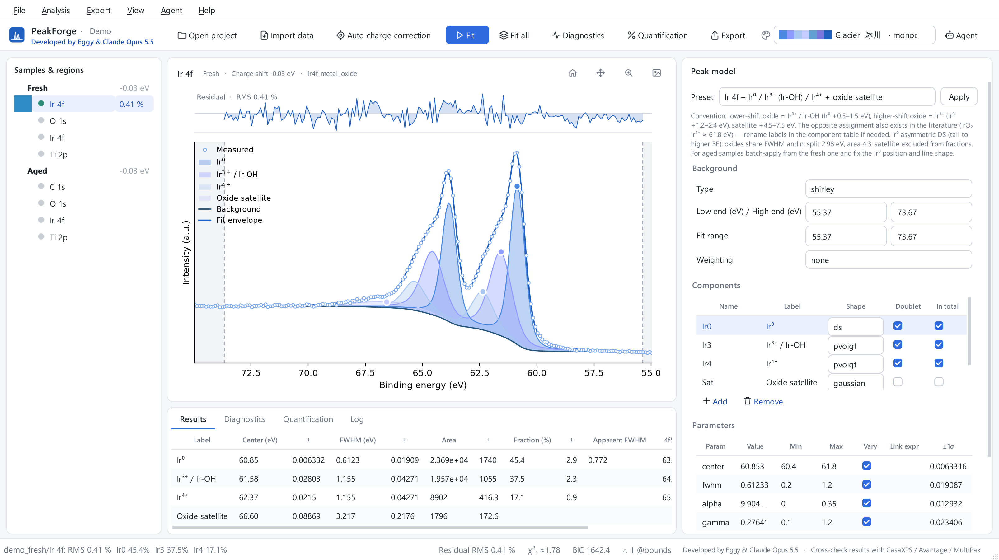
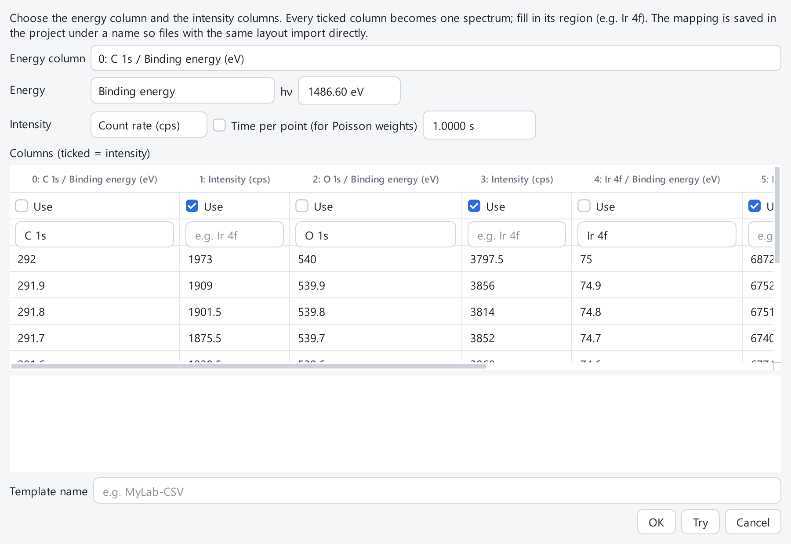
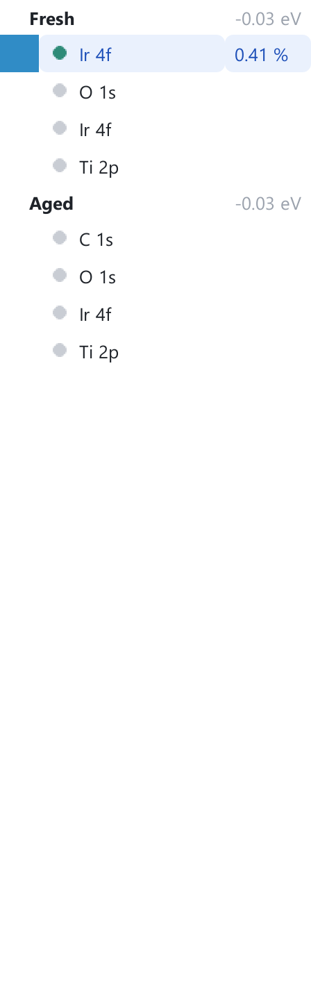
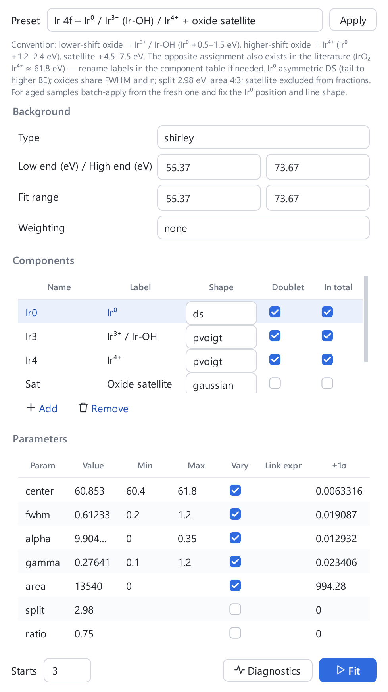
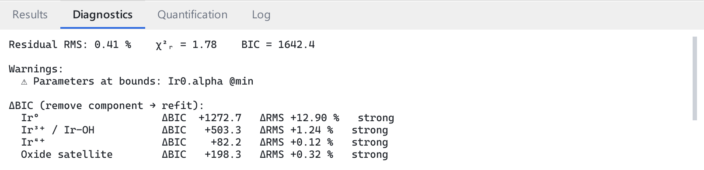
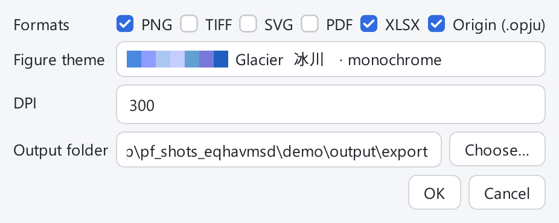
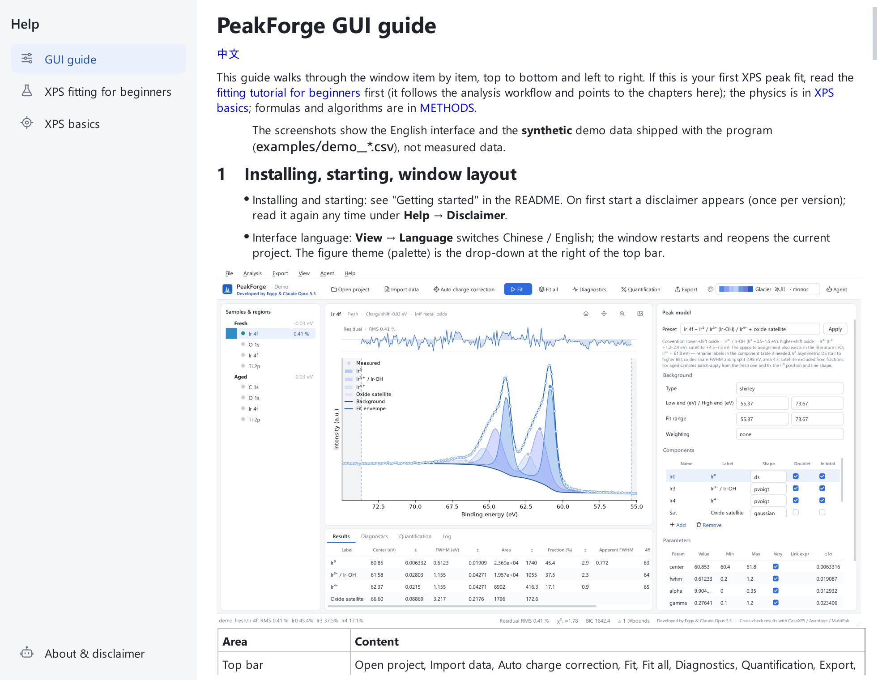

# PeakForge GUI guide

[中文](图形界面使用指南.md)

This guide walks through the window item by item, top to bottom and left to right. If this is your first XPS peak fit, read the
[fitting tutorial for beginners](fitting_tutorial_en.md) first (it follows the analysis workflow and points to the chapters
here); the physics is in [XPS basics](XPS_basics_en.md); formulas and algorithms are in
[METHODS](https://github.com/Wiolic/PeakForge/blob/main/docs/METHODS_en.md).

> The screenshots show the English interface and the **synthetic** demo data shipped with the program
> (`examples/demo_*.csv`), not measured data.

## 1　Installing, starting, window layout

- Installing and starting: see "Getting started" in the README. On first start a disclaimer appears (once per version); read it again
  any time under **Help → Disclaimer**.
- Interface language: **View → Language** switches Chinese / English; the window restarts and reopens the current project. The colours: the drop-down at the right of the top bar picks a *colour combo* for all figures; for one figure right-click the plot → **Colours…** and choose a base colour (the component colours are generated from it, as a "series" or a single-colour "gradient"), or use **View → Colour scheme**. The same element has the same colour in every sample; C 1s / O 1s default to fixed neutrals.

| Area | Content |
|---|---|
| Top bar | Open project, Import data, Auto charge correction, Fit, Fit all, Diagnostics, Quantification, Export, palette, Agent |
| Left: Samples & regions | The sample tree (chapter 4) |
| Centre top: plot | Measured points, components, background, total fit and residual (chapter 6) |
| Centre bottom: results | Four tabs: Results, Diagnostics, Quantification, Log |
| Right: Peak model | Preset, background, components, parameters (chapter 7) |
| Status bar | Hints, task progress bar and Cancel, χ²ᵣ and BIC, credit and disclaimer |

## 2　Projects: new, open, external changes

- **File → New project… (Ctrl+N)**: pick a folder and a name; this creates `name.xpsproj` and the sub-folders `data/raw`, `models`, `presets`, `output`.
- **File → Open project… (Ctrl+O)**, **Recent projects**. A project file with structural errors is refused, naming the file and field; missing data files only give a warning.
- **External changes reload automatically**: when another program (for example an AI agent, chapter 11) modifies the project file, the window reloads it
  and says so in the log. If a background task such as a fit is running, the reload waits until it has finished.
- **Help → Validate project…**: checks the whole project and lists errors (would crash or silently compute wrong) and warnings (runs, but unusual, e.g. too many free parameters).

## 3　Importing data

- **File → Import data… (Ctrl+I)**: select one or more `.spe` (PHI), `.vms` (VAMAS), `.vgp` (Thermo Avantage experiment — keep the `.DATA` folder of the same name next to it; a single `.VGD` also works), `.csv/.txt/.dat/.xy`, `.xlsx/.xls` files. The originals are **copied** to the project's `data/raw`.
  Every region in a file becomes a row in the sample tree; the sample name is the file name.
- When a table **cannot be recognised automatically** the column-mapping wizard opens by itself; you can also open it by hand: **File → Import table with column mapping…**.

In the wizard choose: the energy column; whether energy is binding or kinetic (for kinetic, enter hν; BE = hν − KE); whether intensity is cps or counts and the time per point
(used for Poisson weights; counts without a time are taken as t = 1 s); tick the intensity columns and type the region (element and core level, e.g. `Ir 4f`) for each.
**Try** shows what will be read; give the mapping a **template name** and confirm. The template is stored in the project; files with the same layout can use it directly on the next import.

## 4　The sample tree: status dots, assigning levels, renaming

- Each sample is a bold node with its **charge shift** (eV) in grey on the right; its regions are listed below.
- The dot before a region: **grey** = no model yet; **amber** = model present but not fitted, or the result is stale (the model was edited); **green** = fitted. The number on the right is the residual RMS (%).
- Right-click a sample or region: **Assign element / core level…** (when the reader did not recognise them, e.g. tables), **Set charge shift…**, **Rename sample…** (display name only), **Remove sample**.
- Survey spectra are not fitted and are never selected automatically.

## 5　Charge correction

Charging shifts the whole spectrum; correct it before judging chemical states.

- **Analysis → Auto charge correction (C 1s)**: in each sample's reference region (default C 1s) takes the lowest-BE prominent peak within ±6 eV of the reference (C–C) and moves it to the reference (default 284.8 eV).
  If there is no peak, or the result is doubtful (shift outside −3…+4 eV, weak or broad peak, low-BE shoulder), it is **not applied**: a message box and the log name the sample, the proposed shift and the reasons ("Not corrected automatically") — after checking, enter it with "Set charge shift…".
- **Analysis → Charge reference…**: choose the reference region (e.g. Au 4f, O 1s) and binding energy, stored as the project settings `charge_region` / `charge_ref`.
  The project file may also hold `charge_checks` (e.g. the lattice O 1s of a known oxide): after correction each is checked and a deviation beyond its tolerance is reported.
- When a sample contains a fluoropolymer such as Nafion (a CF₂ peak about 7 eV above C–C in C 1s, or F 1s in the same sample), the shift is applied but a **warning** is shown:
  the insulating membrane may charge differently from the catalyst — check against an internal reference (lattice O 1s, a metal line).
- **Analysis → Set charge shift…**: enter the shift (eV) for the current sample; the current value is shown beside the sample name in the tree.
- When this is trustworthy and the controversy around the C 1s reference: tutorial chapter 3; the uncertainty of the correction itself: METHODS.

## 6　The plot and mouse actions

Four buttons at the top right: reset view, pan, zoom to box, save image. The wheel zooms.

| Action | Effect |
|---|---|
| Right-click empty plot area | Add a peak here; the menu also offers "set background low / high end here" |
| Drag the dot on a peak top | Move that peak (changes its centre) |
| Drag a dashed line | Move a background end |
| Right-click a peak | Remove that component |

The thin strip above is the residual, with its RMS in the title; legend names come from the "Label" column of the components.

## 7　The peak-model panel

The right-hand panel, top to bottom:

1. **Preset**: choose one and press **Apply**. "Auto" picks a preset for the current core level and falls back to a peak search; "Generic: automatic peak search" works for any element. The small text under it gives the preset's conventions and cautions.
2. **Background**: type (Shirley / linear / Tougaard / Smart / none), low and high end (eV), **fit range** (the interval used in the fit; can be narrower than the background ends), **weighting** (none = unweighted; poisson = counting-noise weights).
3. **Components** table: name, label, **shape** (gaussian, lorentzian, pvoigt, GL, SGL, voigt, DS, LA), **doublet** (spin-orbit pair), **in total** (satellites are usually unticked). **Add / Remove** below.
4. **Parameters** table: value, min, max, **vary** (untick = fixed), **link expr** (e.g. `Ir3.fwhm`, binds this parameter to another), ±1σ (error after a fit).
   Expressions may only use parameter references and math functions; a bad expression is rejected before saving.
5. **Starts** (number of multi-start fits), **Fit**, **Diagnostics**.

Editing and undo: **Analysis → Undo / Redo (Ctrl+Z / Ctrl+Y)**; **Save as preset…** stores a tuned model as your own preset. A model with errors is not saved; the log says why.

## 8　Fit, Fit all and batch apply

- **Analysis → Fit (F5)**: fits the current region using the panel's "Starts".
- **Analysis → Fit all (Shift+F5)**: fits every narrow-scan spectrum of the project that has a model (using the panel's "Starts").
- **Analysis → Apply model to others…**: applies the current model to the same region in other samples; choose the targets, **which parameters to fix** (default fwhm, alpha, gamma — "keep the shape, only re-locate position and area") and the number of starts.
- **Progress and cancel**: tasks run in the background; the status bar shows a progress bar and **Cancel**. After a cancel the **project is unchanged** (even results already finished are not written).
- **Discarded results**: if you edit that spectrum's model, reload or switch the project while a fit runs, the result is discarded and the log says so — fit again.
- One failing spectrum does not affect the others; each failure is logged separately.

Result columns: centre, FWHM, area, fraction and their ±1σ; **apparent FWHM** (for the GL product form the parameter width differs from the measured width, see METHODS); the position of a doublet's partner peak.

## 9　Diagnostics

**Analysis → Diagnostics (F6)** (or the button in the panel) fills the "Diagnostics" tab:

- residual RMS, **χ²ᵣ** ("≈" means the noise was estimated from the data), BIC;
- **warnings**: parameters at bounds, abnormal noise ratio (possibly a line-shape mismatch), too many free parameters, …;
- **ΔBIC**: remove each component in turn and refit to see whether it is significant;
- **multi-start stability**: how many starts gave equivalent solutions and the spread of each fraction;
- parameter pairs with correlation |r| ≥ 0.95.

Diagnostics run in the background and can be cancelled. How to read these numbers: tutorial chapter 9.

## 10　Quantification and the result tabs

**Analysis → Quantification** opens the "Quantification" tab: area, RSF and at% per element. The RSF column can be edited to your instrument's values.
**Note**: at% = area/RSF normalised; the built-in RSFs are approximate Scofield cross sections without transmission function, inelastic mean free path or angular correction,
so absolute values can be off by tens of %; see tutorial chapter 11. The "Log" tab records all actions and warnings.

## 11　Export and Agent

**Export → Export… (Ctrl+E)**: choose formats PNG / TIFF / SVG / PDF / Excel / Origin (`.opju`), the colours (default: the project colours incl. per-figure settings; untick to use another combo for this export), DPI and the output folder (default `project/output/export`). The export runs in the background and opens the output folder when done.

**Export → Export current figure… (Ctrl+Shift+E)**, or right-click the plot → **Export this figure…**, writes only the figure on screen; the format follows the extension chosen in the save dialog (`.png` `.svg` `.pdf` `.tif`, or `.opju` for a one-graph Origin project — without Origin the data and a build script are written). CLI: `peakforge export <project> --key <spectrum> --out FILE`; MCP: `export_figure`.
The Excel file holds component parameters, fit quality, quantification, curve data and the disclaimer. **Without Origin/originpro** the Origin item writes the data and a script `build_origin.py`;
run `run -pyf build_origin.py` in Origin to get the project. Figures and exports are always in English.

**Agent → Connect AI agent (MCP)…**: choose the data folder; PeakForge writes `.mcp.json` and `AGENTS.md` there. Open that folder in the Claude desktop app's Code tab and allow the "peakforge" server;
then you can ask the AI in plain language to analyse the project. The agent's changes appear in the window through the external reload of chapter 2.

## 12　The Help menu

- **User guide (F1)**: this window — three documents (GUI guide, XPS fitting for beginners, XPS basics) and "About & disclaimer". It is a separate window you can place beside the main one; documents follow the interface language.
- **Disclaimer**, **Validate project…** (chapter 2).
- **Export diagnostics bundle…**: writes a zip (log, versions and environment, project and model JSON; **no raw data or spectra**) and opens its folder.
- **Open log folder**, **About**.

## Appendix

### A　Where the files are

| Location | Content |
|---|---|
| `project folder/name.xpsproj` | the project (JSON): samples, charge shifts, column templates, settings |
| `project folder/data/raw` | the original files copied at import |
| `project folder/models` | model and fit result of each region |
| `project folder/presets` | presets you saved |
| `project folder/output` | exports |
| `~/.peakforge/settings.json` | language, recent projects, disclaimer-read marks |
| `~/.peakforge/peakforge.log` | rolling log |
| `examples` in the install folder | synthetic demo data `demo_fresh.csv`, `demo_aged.csv` |

### B　Frequently asked questions

- **After importing a table the energy runs the wrong way / intensities are tiny**: use the column-mapping wizard to say BE or KE, cps or counts.
- **"Not corrected automatically"**: no reliable C 1s peak was found in that sample; use "Set charge shift…".
- **A model is "rejected / not loaded"**: the model file has validation errors; re-apply a preset or fix it as the message says. "Validate project…" lists all problems.
- **No result after a fit**: the log says "result discarded" — the model changed during the fit; fit again.
- **`@min` / `@max` warning on a parameter**: it hit a bound; widen the range or check the model. Why the Ir⁰ α hits its lower bound in the demo data: tutorial chapter 10.

### C　What to do on errors

A message box shows only the first line; details are in the log. Use **Help → Export diagnostics bundle…** and send the zip to the developer (no raw data), saying what you did.
