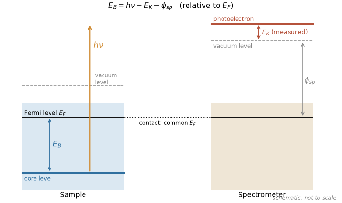
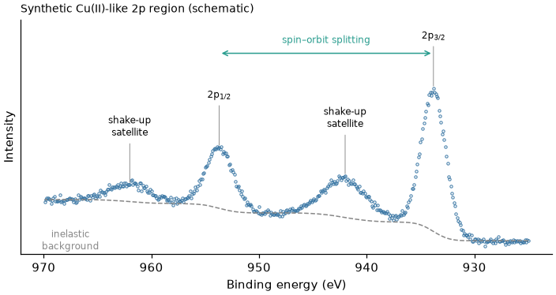
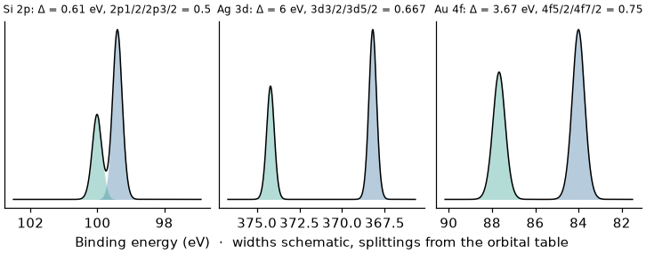
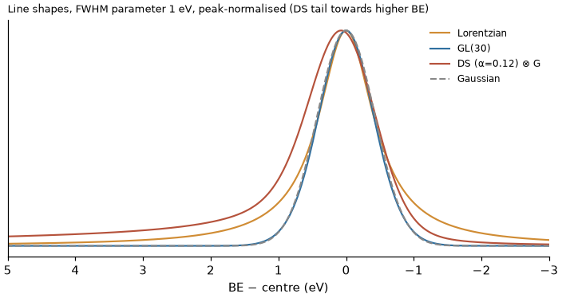
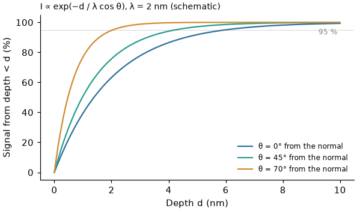
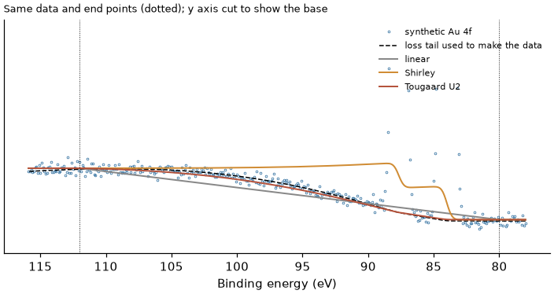

# XPS basics

[中文](XPS基础讲义.md)

These notes explain the physics behind an XPS (X-ray photoelectron spectroscopy) spectrum, so that you **know where every
feature comes from** and therefore what to put into a fit and what not. The steps in the program are in the
[fitting tutorial](fitting_tutorial_en.md); exactly what PeakForge computes (formulas, conventions, known limitations) is in
[METHODS](https://github.com/Wiolic/PeakForge/blob/main/docs/METHODS_en.md). Every number has a source, listed under
"References" at the end; [n] refers to that list.

**Contents**

| Part | Sections |
|---|---|
| I. How it works | 1 Photoemission and binding energy　2 The instrument: source and analyser |
| II. What is in a spectrum | 3 Spectral features　4 Spin–orbit splitting　5 Chemical shifts and final-state effects　6 Line widths and shapes |
| III. Sample and energy scale | 7 Surface sensitivity　8 Charging and energy referencing |
| IV. From peaks to conclusions | 9 The physics of the background　10 Quantification　11 What XPS can and cannot tell you |

---

## I. How it works

### 1　Photoemission and binding energy

An X-ray photon of energy $h\nu$ is absorbed and ejects a core-level electron, the **photoelectron**, whose kinetic
energy $E_K$ is measured by the analyser. For a conducting sample in electrical contact with the spectrometer the two
Fermi levels are aligned, and

$$E_B = h\nu - E_K - \phi_{sp}$$

| Symbol | Meaning |
|---|---|
| $E_B$ | binding energy, **relative to the Fermi level** |
| $h\nu$ | photon energy (known, section 2) |
| $E_K$ | measured kinetic energy |
| $\phi_{sp}$ | work function of the **spectrometer** (set by calibration), independent of the sample |

Key points:

- Each core level of each element has an almost fixed $E_B$, so **position → element**; the chemical environment shifts
  it by tenths of an eV to a few eV, so **shift → chemical state** (section 5).
- The energy scale is calibrated with reference metals. ISO 15472 reference values (monochromated Al Kα):
  Au 4f₇/₂ 83.96 eV, Ag 3d₅/₂ 368.21 eV, Cu 2p₃/₂ 932.62 eV [1].
- An insulating sample is not in Fermi-level equilibrium with the spectrometer and charges positively, shifting the
  whole spectrum to higher $E_B$ — section 8.
- XPS programs (PeakForge included) plot binding energy **decreasing from left to right**, which is the direction of
  increasing kinetic energy.

### 2　The instrument: source and analyser

**X-ray sources** [2, 3]

| Source | $h\nu$ | Line width (FWHM) | Notes |
|---|---|---|---|
| Mg Kα (non-monochromated) | 1253.6 eV | ≈ 0.7 eV | X-ray satellites Kα₃,₄ etc. |
| Al Kα (non-monochromated) | 1486.6 eV | ≈ 0.85 eV | as above |
| Al Kα (monochromated) | 1486.6 eV | of order 0.3 eV | most common on modern instruments; no X-ray satellites, no Bremsstrahlung |

- A non-monochromated source also emits Kα₃,₄ lines about 8–12 eV **higher** in energy, a few % of the main line; they
  produce small "ghost" peaks on the **low-binding-energy** side [3]. Monochromated sources do not.
- If the source is changed between Mg and Al, photoelectron peaks keep their $E_B$, whereas **Auger peaks** keep their
  kinetic energy and their apparent $E_B$ moves by the difference in $h\nu$, 233 eV. This is the classic way to tell them apart.

**Analyser**: usually hemispherical, operated at a fixed **pass energy**. Lower pass energy gives better energy
resolution but fewer counts [2]. Narrow (high-resolution) scans typically use a low pass energy (e.g. 10–40 eV),
surveys a high one (e.g. 100–200 eV). **Spectra you want to compare should be recorded at the same pass energy** —
widths, intensities and the transmission function all change with it.

**Counts and noise**: the detector counts electrons, which follow Poisson statistics: a point with $N$ counts has a
standard deviation of $\sqrt{N}$. The "cps" (counts per second) shown by most programs must be multiplied by the time
per point to get counts back. This decides the weights and the meaning of χ²ᵣ in a fit; see METHODS section 4 for
how PeakForge handles it.

---

## II. What is in a spectrum

### 3　Spectral features

A narrow scan usually contains:

| Feature | Origin | In a fit |
|---|---|---|
| **Photoelectron peak** | photoelectrons that left without energy loss | the main object of the fit |
| **Spin–orbit doublet** | p, d, f levels split into two j levels (section 4) | placed as pairs, ratio and splitting constrained |
| **Shake-up satellite** | a valence electron is excited during photoionisation and takes some energy → appears a few eV on the **high-$E_B$** side | its own component, usually **excluded** from chemical-state fractions |
| **Multiplet splitting** | coupling of the core hole with unpaired valence electrons (2p and 3s of Mn, Fe, Co, Ni, Cr…) | complex shape, not one doublet |
| **Energy loss (plasmons)** | collective excitations on the way out; strong for metallic Al, Mg, Si | model it or keep it out of the window |
| **Inelastic background** | electrons that lost energy by inelastic scattering → step and tail on the high-$E_B$ side | handled by the background (section 9) |
| **Auger peaks** | Auger electrons from core-hole decay | do not mistake them for photoelectron peaks (source change, section 2) |

The figure is a **synthetic** Cu(II)-like 2p region: the 2p₃/₂ and 2p₁/₂ doublet, a strong shake-up satellite on
the high-$E_B$ side of each, and the raised inelastic background after the peaks. The strong shake-up of Cu²⁺
compounds is exactly what identifies Cu(II); Cu⁰ and Cu⁺ show almost none [4].

**Auger parameter**: the sum of a photoelectron $E_B$ and an Auger kinetic energy of the same element,
$\alpha' = E_B + E_K(\mathrm{Auger})$, does not depend on charging and helps to identify chemical states when charge
referencing is unreliable [5].

### 4　Spin–orbit splitting

Levels with orbital angular momentum $l>0$ (p, d, f) split by spin–orbit coupling into $j=l\pm 1/2$. The **area ratio**
of the two peaks follows from the degeneracy $2j+1$:

| Level | Components | Degeneracy $2j+1$ | Area ratio (low j / high j) |
|---|---|---|---|
| p | p₁/₂, p₃/₂ | 2, 4 | 1 : 2 = 0.5 |
| d | d₃/₂, d₅/₂ | 4, 6 | 2 : 3 ≈ 0.667 |
| f | f₅/₂, f₇/₂ | 6, 8 | 3 : 4 = 0.75 |

- The high-j component (p₃/₂, d₅/₂, f₇/₂) is at **lower** $E_B$ and stronger.
- The **splitting** depends on element and level; between chemical states of one element it usually changes by only
  tenths of an eV. Examples from PeakForge's orbital table (checked against `data/orbitals.json` by a test):

<!-- check: orbitals -->
| Level | Typical BE (eV) | Splitting (eV) | Area ratio |
|---|---|---|---|
| Si 2p | 99.4 | 0.61 | 0.5 |
| Ti 2p | 453.9 | 6.1 | 0.5 |
| Cu 2p | 932.6 | 19.8 | 0.5 |
| Ag 3d | 368.2 | 6.0 | 0.667 |
| Pt 4f | 71.1 | 3.33 | 0.75 |
| Au 4f | 84.0 | 3.67 | 0.75 |

(BEs are approximate handbook values for the element or a common state — fit start values, not reference data; rely on
your calibration and trusted literature.)

Note:

- A small splitting (Si 2p, 0.61 eV) merges the two peaks into one asymmetric peak — it **must still be fitted as a
  doublet**, otherwise position and width are wrong.
- Measured area ratios can deviate from $2j+1$, and the widths need not be equal: in 3d transition metals the 2p₁/₂
  line is clearly broader because **Coster–Kronig** decay shortens its lifetime (e.g. Ti 2p) [6]. An "equal widths"
  constraint is then wrong; free the 2p₁/₂ width or fit the 2p₃/₂ line only.

### 5　Chemical shifts and final-state effects

**Chemical shift**: when an atom loses electron density (oxidation) its core electrons are less screened and $E_B$
usually **increases**. Examples [2, 7]:

- Si 2p: Si⁰ and SiO₂ differ by about 4 eV;
- C 1s: relative to C–C/C–H, C–O ≈ +1.5 eV, C=O ≈ +3 eV, O–C=O ≈ +4 eV.

**"Higher oxidation state, higher $E_B$" is not a law.** The measured $E_B$ reflects both the initial state (bonding,
charge) and the **final state** (relaxation and screening around the core hole). Strong relaxation can give anomalous
shifts; shake-up and multiplet splitting are final-state effects too. **Assign chemical states from reliable reference
compounds and literature**, not from the sign of a shift alone.

### 6　Line widths and shapes

The width of a photoelectron peak has several contributions [2, 8]:

| Source | Shape | Notes |
|---|---|---|
| Core-hole lifetime $\tau$ | **Lorentzian** | width $\Gamma = \hbar/\tau$, $\hbar = 6.582\times10^{-16}$ eV·s; a 1 fs lifetime gives ≈ 0.66 eV |
| Source line width, analyser resolution | roughly **Gaussian** | changes with pass energy |
| Phonon broadening, sample inhomogeneity (several environments, slightly uneven charging) | **Gaussian** | often dominant for insulators and disordered samples |

The measured peak is therefore a **convolution** of Lorentzian and Gaussian (a Voigt profile); in practice
approximations are used: GL (Gaussian–Lorentzian product), SGL (sum) and pseudo-Voigt.

**Asymmetry of metals**: when the core hole appears in a metal, conduction electrons near the Fermi level can be
excited into many low-energy electron–hole pairs, so the photoelectron very often loses a small amount of energy and
the peak has a tail towards **higher $E_B$**. The Doniach–Šunjić (DS) line shape describes this [9]. Hence:

- metals (Pt⁰, Au⁰, Ir⁰, Pd⁰ …) take an **asymmetric** shape (DS or LA);
- insulators and most oxides take a **symmetric** shape (GL, Voigt).

The DS tail decays so slowly that its area does not converge; an integration range must be agreed on — PeakForge's
convention, and the resulting rule "compare DS areas only within PeakForge", are in METHODS section 2.

---

## III. Sample and energy scale

### 7　Surface sensitivity

After some distance in the solid a photoelectron is scattered inelastically and no longer belongs to the peak. The mean
distance is the **inelastic mean free path**, IMFP (λ). Signal from depth $d$ is attenuated as $\exp(-d/\lambda\cos\theta)$
(θ: emission angle from the surface normal), so:

- 95 % of the signal comes from within $3\lambda\cos\theta$ ($1-e^{-3}\approx 0.95$) — the **information depth**;
- for most photoelectrons excited by Al Kα, λ is of order 1–3 nm, so the information depth is several nm up to about
  ten nm [10, 11];
- the lower the kinetic energy (the higher the $E_B$ of the peak), the smaller λ and the more surface-sensitive;
- a larger emission angle θ (grazing emission) is more surface-sensitive — the basis of angle-resolved XPS.

Consequence: XPS measures the **top few nanometres**, not the bulk; adventitious carbon, adsorbed water and oxide
layers strongly affect the result.

### 8　Charging and energy referencing

Insulating or poorly conducting samples charge positively as they emit photoelectrons; the whole spectrum moves to
**higher $E_B$**, by several eV or more, and the shift can drift with time and position. A **flood gun** (low-energy
electrons/ions) compensates, but the absolute energy after compensation is still not reliable and must be referenced to
a known peak [12].

Common practice and its problems:

| Method | How | Limitation |
|---|---|---|
| Adventitious carbon (AdC) C 1s | set the C–C/C–H peak to 284.8 eV (285.0 eV is also used) | AdC C 1s can differ by more than 1 eV between samples and depends on the sample work function [13]; a thin, uneven carbon layer can also charge differentially |
| Internal reference | a component of known, unchanged chemistry (support Si 2p, a known ligand) | needs such a component |
| Evaporated gold / admixed standard | Au 4f₇/₂ etc. | may alter the surface; Au and sample are not necessarily at the same potential |
| Auger parameter | section 3 | a chemical-state criterion, not a correction |

PeakForge's "Auto charge correction (C 1s)" looks for the strongest peak within 283–287 eV, fits its low-BE side and top,
and moves it to the reference (default 284.8 eV, a project setting); when no reliable peak is found it **refuses** and
reports the sample — the criteria are in METHODS section 7. **State the reference peak and value in publications** so
that others can convert.

---

## IV. From peaks to conclusions

### 9　The physics of the background

The high-$E_B$ side of a peak is higher than the low-$E_B$ side: these are **inelastically scattered** electrons that
belonged to the peak but lost energy on the way out, and so appear at a higher "apparent $E_B$". A background model
approximates them:

| Model | Assumption | Use |
|---|---|---|
| Linear | straight line between the end points | small steps, or as a comparison |
| **Shirley** [14] | background at a point ∝ peak area on its low-$E_B$ side → the whole step sits under the peak | most common; the window only needs the peak plus a few eV |
| **Tougaard** [15] | the peak convolved with a physical energy-loss cross section $K(T)$ (universal two-parameter form $K = BT/(C+T^2)^2$, C = 1643 eV²) | closer to the physics; needs a window extending tens of eV past the peak |

The figure shows a **synthetic** Au 4f spectrum whose tail was generated with the universal Tougaard cross section
(black dashed line). With the same window (dotted lines) the Tougaard background follows the true loss (the data were
made with this cross section, so agreement is expected; a real sample's cross section need not be the universal one);
Shirley puts the whole step under the two peaks and lies above the true background after them; the linear background
lies below it after the peaks.

Conclusions:

- Background type and end points **change areas**, sometimes fractions by several percent or more. This uncertainty is
  **not** part of the error reported by the fit (METHODS sections 3 and 5).
- With Shirley, put the high-BE end a few eV past the peaks, where the curve has just flattened; with Tougaard use a
  wide window.
- When comparing a series of samples, **the same background type and similar end-point rules** matter more than an
  "absolutely correct" background.

### 10　Quantification

The peak area of element i is approximately

$$I_i \propto n_i\,\sigma_i\,\lambda_i\,T(E_{K,i})\,L_i$$

with atom density $n_i$, photoionisation cross section $\sigma_i$ (Scofield's calculation [16]), IMFP $\lambda_i$, analyser
transmission $T$ and angular asymmetry factor $L_i$. In practice all factors except $n$ are combined into a **relative
sensitivity factor RSF**: $\mathrm{at}\%_i = (I_i/\mathrm{RSF}_i)/\sum_j (I_j/\mathrm{RSF}_j)$.

- This assumes a sample that is **homogeneous** over the information depth. For layered samples (oxide films,
  coatings, adsorbates) the "at%" is only an apparent value.
- RSFs depend on the instrument (transmission, geometry). PeakForge's built-in values are approximate Scofield cross
  sections **without** transmission, IMFP and angular corrections; absolute at% can be off by tens of percent. Enter
  your instrument's RSFs for quantitative work (METHODS section 8).
- **Relative fractions** of chemical states of one element (the % from a fit) need no RSF, provided satellites are
  treated consistently for all components.

### 11　What XPS can and cannot tell you

**It can tell you**: which elements are in the top few nanometres (not H, He); roughly how much (detection limits
typically about 0.1–1 at% [2]); chemical states and their relative proportions; **relative** changes between treatments
or samples.

**It cannot, or only with care**:

- bulk composition — XPS sees the surface;
- chemical-state assignment — from positions alone, without reference compounds, assignments can be disputed (e.g. the
  O 1s component near 531 eV is often attributed to "oxygen vacancies", an assignment that is contested [17]);
- absolute energies — charge referencing of insulators is uncertain by tenths of an eV (section 8);
- the number of components a fit gives — mathematically "better" is not physically present (see "Is the fit good?" in
  the tutorial).

---

## Further reading and references

Further reading: [2] is the standard introduction; [18] is a recent review of peak-fitting practice — strongly
recommended before writing a paper.

1. ISO 15472:2010, *Surface chemical analysis — X-ray photoelectron spectrometers — Calibration of energy scales*; M. P. Seah, Surf. Interface Anal. 31 (2001) 721.
2. D. Briggs, M. P. Seah (eds.), *Practical Surface Analysis*, Vol. 1, 2nd ed., Wiley, 1990.
3. J. F. Moulder, W. F. Stickle, P. E. Sobol, K. D. Bomben, *Handbook of X-ray Photoelectron Spectroscopy*, Perkin-Elmer, 1992.
4. M. C. Biesinger, Surf. Interface Anal. 49 (2017) 1325 (analysis of Cu 2p spectra).
5. C. D. Wagner, Faraday Discuss. Chem. Soc. 60 (1975) 291 (Auger parameter).
6. J. C. Fuggle, S. F. Alvarado, Phys. Rev. A 22 (1980) 1615 (core-level lifetimes, Coster–Kronig broadening).
7. G. Beamson, D. Briggs, *High Resolution XPS of Organic Polymers*, Wiley, 1992.
8. S. Hüfner, *Photoelectron Spectroscopy*, 3rd ed., Springer, 2003.
9. S. Doniach, M. Šunjić, J. Phys. C 3 (1970) 285.
10. S. Tanuma, C. J. Powell, D. R. Penn, Surf. Interface Anal. 21 (1994) 165 (TPP-2M).
11. C. J. Powell, A. Jablonski, *NIST Electron Inelastic-Mean-Free-Path Database* (SRD 71).
12. D. R. Baer et al., J. Vac. Sci. Technol. A 38 (2020) 031204 (charge neutralisation and BE referencing of insulators).
13. G. Greczynski, L. Hultman, Prog. Mater. Sci. 107 (2020) 100591.
14. D. A. Shirley, Phys. Rev. B 5 (1972) 4709.
15. S. Tougaard, Surf. Sci. 216 (1989) 343.
16. J. H. Scofield, J. Electron Spectrosc. Relat. Phenom. 8 (1976) 129.
17. T. J. Frankcombe, Y. Liu, Chem. Mater. (2023) (interpretation of O 1s spectra of ZnO).
18. G. H. Major et al., J. Vac. Sci. Technol. A 38 (2020) 061203 (practical guide to XPS peak fitting).
