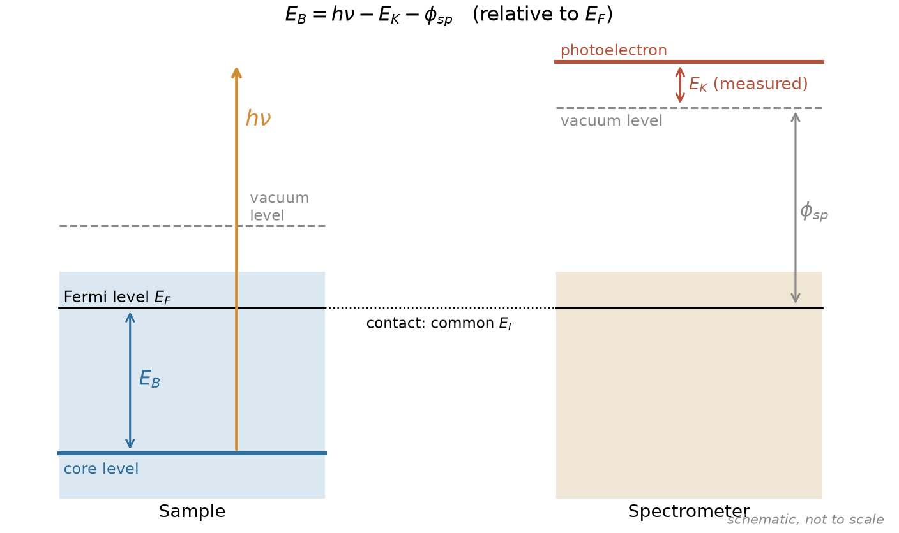
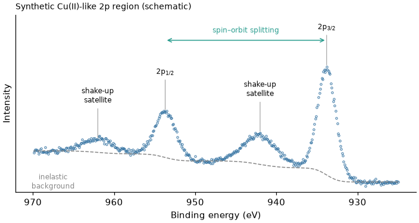
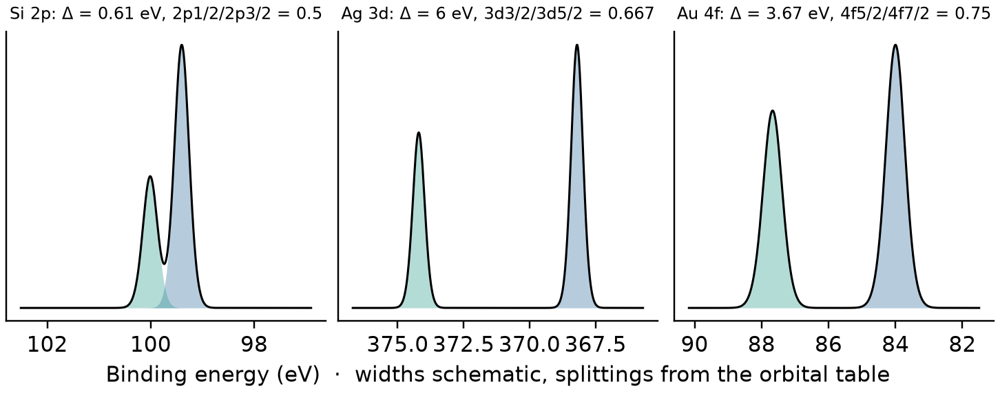
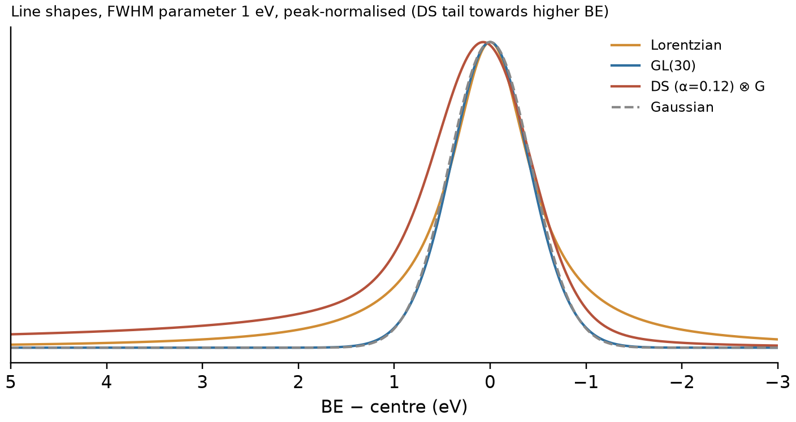
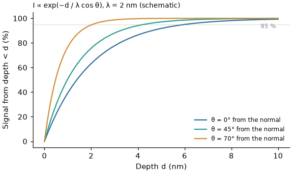
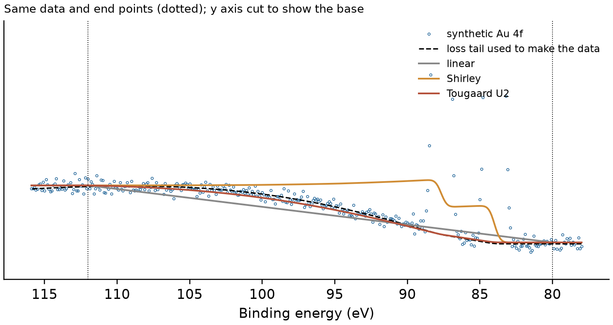

# XPS 基础讲义

[English](XPS_basics_en.md)

这份讲义讲 XPS（X 射线光电子能谱）的物理基础，目的是让你**看懂谱图里每一个特征从哪来**，从而知道拟合时该放什么、不该放什么。
操作步骤见 [零基础 XPS 拟合教程](零基础XPS拟合教程.md)；PeakForge 具体怎么算（公式、约定、已知局限）见
[方法说明 METHODS](https://github.com/Wiolic/PeakForge/blob/main/docs/METHODS.md)。文中的数值都有出处，列在文末“参考文献”，方括号 [n] 为编号。

**目录**

| 部分 | 章节 |
|---|---|
| 一、测量原理 | 1 光电效应与结合能　2 仪器：光源与分析器 |
| 二、谱里有什么 | 3 谱的组成　4 自旋轨道分裂　5 化学位移与终态效应　6 线宽与线型 |
| 三、样品与能量标尺 | 7 表面灵敏度　8 荷电与能量校正 |
| 四、从峰到结论 | 9 背景的物理　10 定量　11 XPS 能回答什么、不能回答什么 |

---

## 一、测量原理

### 1　光电效应与结合能

能量为 $h\nu$ 的 X 射线光子被原子吸收，把一个内层（芯能级）电子打出样品，成为**光电子**。分析器测量它的动能 $E_K$。
对与谱仪电接触的导电样品，样品和谱仪的费米能级对齐，于是

$$E_B = h\nu - E_K - \phi_{sp}$$

| 符号 | 含义 |
|---|---|
| $E_B$ | 结合能，**以费米能级为零点** |
| $h\nu$ | 光子能量（已知，见第 2 节） |
| $E_K$ | 测得的动能 |
| $\phi_{sp}$ | **谱仪**的功函数（仪器标定时确定），与样品功函数无关 |

要点：

- 每种元素每个芯能级的 $E_B$ 基本固定，所以**峰位 → 元素**；周围化学环境让它移动零点几到几个 eV，所以**位移 → 化学态**（第 5 节）。
- 谱仪先用标准金属定好能量标尺。ISO 15472 推荐的参考值（单色 Al Kα）：Au 4f₇/₂ 83.96 eV、Ag 3d₅/₂ 368.21 eV、Cu 2p₃/₂ 932.62 eV [1]。
- 绝缘样品与谱仪之间费米能级不再对齐，还会带正电（荷电），整张谱向高 $E_B$ 偏移——第 8 节。
- XPS 软件（包括 PeakForge）一般以结合能为横轴，**从左到右 BE 减小**，这样与动能方向一致。

### 2　仪器：光源与分析器

**光源** [2, 3]

| 光源 | $h\nu$ | 线宽（FWHM） | 说明 |
|---|---|---|---|
| Mg Kα（非单色） | 1253.6 eV | 约 0.7 eV | 有 Kα₃,₄ 等 X 射线卫星线 |
| Al Kα（非单色） | 1486.6 eV | 约 0.85 eV | 同上 |
| Al Kα（单色化） | 1486.6 eV | 约 0.3 eV 量级 | 现代仪器最常用；无 X 射线卫星线、无韧致辐射 |

- 非单色光源除主线外还有能量**高**约 8–12 eV 的 Kα₃,₄ 卫星线，强度为主线的几 %，它们在**低结合能**一侧产生小的“鬼峰” [3]。用单色光源时没有这个问题。
- 同一样品换 Mg/Al 光源时，光电峰的 $E_B$ 不变，而**俄歇峰**的动能不变、表观 $E_B$ 改变（相差 $h\nu$ 之差 233 eV）。这是区分两者的经典办法。

**分析器**：多为半球型分析器，以固定**通能**（pass energy）工作。通能越低，能量分辨率越好，但计数越少 [2]。
窄谱（high-resolution）一般用低通能（如 10–40 eV），全谱用高通能（如 100–200 eV）。
**同一组比较的谱应在同一通能下采集**——线宽、强度、透射函数都随通能变化。

**计数与噪声**：探测器数的是电子个数，服从泊松统计：每点计数 $N$ 的标准差为 $\sqrt{N}$。
软件里显示的“cps”（每秒计数）要乘以每点采集时间才回到计数。这决定了拟合的权重与 χ²ᵣ 的含义，PeakForge 的处理见 METHODS 第 4 节。

---

## 二、谱里有什么

### 3　谱的组成

一张窄谱通常包含：

| 特征 | 来源 | 拟合时 |
|---|---|---|
| **光电峰** | 无损失逃出的光电子 | 主要拟合对象 |
| **自旋轨道双峰** | p、d、f 能级分裂成两个 j 能级（第 4 节） | 成对放，比例与间距约束 |
| **震激（shake-up）卫星** | 光电离同时价电子被激发，带走一部分能量 → 出现在主峰**高 $E_B$** 侧几 eV 处 | 单独放峰，通常**不计入**化学态占比 |
| **多重态分裂** | 芯空穴与未配对价电子耦合（Mn、Fe、Co、Ni、Cr 的 2p 与 3s 等） | 峰形复杂，不能用单个双峰描述 |
| **能量损失（等离激元）** | 逃逸途中激发集体振荡；金属 Al、Mg、Si 等明显 | 在窗口内时需建模或避开 |
| **非弹性背景** | 逃逸途中发生非弹性散射、损失了能量的电子 → 峰高 $E_B$ 侧的台阶与拖尾 | 用背景处理（第 9 节） |
| **俄歇峰** | 芯空穴弛豫放出的俄歇电子 | 不要与光电峰混淆（见第 2 节换光源法） |

上图是**合成的** Cu(II) 型 2p 区域示意：2p₃/₂ 与 2p₁/₂ 双峰、各自高 $E_B$ 侧的强震激卫星、以及峰后抬高的非弹性背景。
Cu²⁺ 化合物的强震激卫星正是判断 Cu(II) 的依据，而 Cu⁰ 与 Cu⁺ 几乎没有 [4]。

**俄歇参数**：同一元素的光电峰 $E_B$ 与俄歇峰动能之和 $\alpha' = E_B + E_K(\mathrm{Auger})$ 不受荷电影响，可用于在荷电校正不可靠时辅助判断化学态 [5]。

### 4　自旋轨道分裂

角量子数 $l>0$ 的能级（p、d、f）因自旋轨道耦合分裂为 $j=l\pm 1/2$ 两个能级。两峰的**面积比**由简并度 $2j+1$ 决定：

| 能级 | 两个分量 | 简并度 $2j+1$ | 面积比（低 j / 高 j） |
|---|---|---|---|
| p | p₁/₂、p₃/₂ | 2、4 | 1 : 2 = 0.5 |
| d | d₃/₂、d₅/₂ | 4、6 | 2 : 3 ≈ 0.667 |
| f | f₅/₂、f₇/₂ | 6、8 | 3 : 4 = 0.75 |

- 高 j 分量（p₃/₂、d₅/₂、f₇/₂）在**低** $E_B$ 侧且更强。
- **劈裂**（两峰间距）随元素与能级而异，同一元素不同化学态之间通常只差零点几 eV。PeakForge 能级表中的例子（本表数值由测试与 `data/orbitals.json` 核对）：

<!-- check: orbitals -->
| 能级 | 典型 BE（eV） | 劈裂（eV） | 面积比 |
|---|---|---|---|
| Si 2p | 99.4 | 0.61 | 0.5 |
| Ti 2p | 453.9 | 6.1 | 0.5 |
| Cu 2p | 932.6 | 19.8 | 0.5 |
| Ag 3d | 368.2 | 6.0 | 0.667 |
| Pt 4f | 71.1 | 3.33 | 0.75 |
| Au 4f | 84.0 | 3.67 | 0.75 |

（表中 BE 为单质或常见化学态的近似手册值，只作拟合起点，不是参考数据；以你的仪器标定与可靠文献为准。）

注意：

- 劈裂小的能级（如 Si 2p 的 0.61 eV）两峰重叠成一个不对称峰，**仍然必须按双峰拟合**，否则峰位与宽度都是错的。
- 实测面积比可偏离 $2j+1$ 值，宽度也不一定相同：3d 过渡金属的 2p₁/₂ 因 **Coster–Kronig** 衰变寿命更短而明显更宽（如 Ti 2p）[6]。
  这时“两峰同宽”的约束不成立，应放开 2p₁/₂ 宽度或只拟合 2p₃/₂。

### 5　化学位移与终态效应

**化学位移**：原子失去电子（氧化）后，芯电子感受到的屏蔽减少，$E_B$ 通常**升高**。例子 [2, 7]：

- Si 2p：Si⁰ 与 SiO₂ 相差约 4 eV；
- C 1s：相对 C–C/C–H，C–O 约 +1.5 eV，C=O 约 +3 eV，O–C=O 约 +4 eV。

**但“氧化态越高 $E_B$ 越高”不是定律**。测到的 $E_B$ 是初态（化学键、电荷）与**终态**（芯空穴产生后周围电子的弛豫屏蔽）共同决定的。
弛豫强的体系可出现反常位移；震激、多重态分裂也属于终态效应。所以**化学态的归属应依据可靠的参考化合物与文献**，不能只凭位移的正负。

### 6　线宽与线型

一个光电峰的宽度来自几部分 [2, 8]：

| 来源 | 线型 | 说明 |
|---|---|---|
| 芯空穴寿命 $\tau$ | **洛伦兹** | 宽度 $\Gamma = \hbar/\tau$，$\hbar = 6.582\times10^{-16}$ eV·s；寿命 1 fs 对应约 0.66 eV |
| 光源线宽、分析器分辨率 | 近似**高斯** | 随通能变化 |
| 声子展宽、样品不均匀（多种近邻环境、微小荷电不均） | **高斯** | 绝缘体与无序样品中常占主导 |

所以实测峰是洛伦兹与高斯的**卷积**（Voigt），实用中常用其近似：GL（高斯–洛伦兹乘积）、SGL（加和）、pseudo-Voigt。

**金属的不对称**：金属中芯空穴出现时，费米能级附近的导带电子可被激发成无数低能电子–空穴对，于是光电子损失少量能量的概率很大，
峰向**高 $E_B$** 侧拖尾。Doniach–Šunjić（DS）线型描述了这种拖尾 [9]。所以：

- 金属（Pt⁰、Au⁰、Ir⁰、Pd⁰ 等）用**不对称**线型（DS 或 LA）；
- 绝缘体、大多数氧化物用**对称**线型（GL、Voigt）。

DS 拖尾下降得很慢，面积在数学上不收敛，必须约定积分范围——PeakForge 的约定和由此带来的“DS 面积只能在本软件内部比较”见 METHODS 第 2 节。

---

## 三、样品与能量标尺

### 7　表面灵敏度

光电子在固体中走一段距离就会发生非弹性散射而失去“峰”的身份。平均走多远由**非弹性平均自由程** IMFP（λ）描述。
来自深度 $d$ 的信号按 $\exp(-d/\lambda\cos\theta)$ 衰减（θ 为出射方向与表面法线的夹角），因此：

- 95 % 的信号来自 $3\lambda\cos\theta$ 以内（$1-e^{-3}\approx 0.95$）——这就是常说的**信息深度**；
- Al Kα 激发的大多数光电子 λ 在 1–3 nm 量级，信息深度约几 nm 到十纳米 [10, 11]；
- 动能越低（$E_B$ 越高的峰）λ 越小，越表面灵敏；
- 加大出射角 θ（掠出射）更表面灵敏——这是角分辨 XPS 的原理。

推论：XPS 测的是**表面几纳米**，不是体相组成；表面污染碳、吸附水、氧化层都会显著影响结果。

### 8　荷电与能量校正

绝缘或导电不良的样品发射光电子后带正电，整张谱向**高 $E_B$** 偏移，偏移量可达数 eV 甚至更多，而且可能随时间、位置变化。
仪器用**中和枪**（低能电子/离子）补偿，但补偿后的绝对能量仍不可信，需要用参考峰校正 [12]。

常见做法与它们的问题：

| 方法 | 做法 | 局限 |
|---|---|---|
| 外来污染碳（AdC）C 1s | 把 C–C/C–H 峰设为 284.8 eV（也有用 285.0 eV 的） | 不同样品上 AdC 的 C 1s 可相差 1 eV 以上，且与样品功函数相关 [13]；薄、不均匀的碳层还会带来差分荷电 |
| 内标 | 用组成已知、化学态不变的组分（如载体的 Si 2p、某个已知配体） | 需要有这样的组分 |
| 蒸镀金 / 混入标准物 | 用 Au 4f₇/₂ 等 | 可能改变表面；Au 与样品不一定等电位 |
| 俄歇参数 | 第 3 节 | 只给化学态判据，不直接给校正量 |

PeakForge 的“自动荷电校准（C 1s）”在参考值 ±6 eV 内取 **BE 最低**的明显峰（C–C 位于 C–O、C=O、CF₂ 以及常落在 C 1s 窗口里的
K 2p、Ir 4d 之下），局部拟合后移到参考值（默认 284.8 eV；参考谱区与参考值都是工程设置，例如 Au 4f7/2 84.0 eV）；
结果可疑（位移过大、峰弱或过宽、低 BE 侧有未分开的肩峰）时**不套用**，报告该样品与建议位移——具体判据见 METHODS 第 7 节。**发表时请写明参考峰与参考值**，以便他人换算。

---

## 四、从峰到结论

### 9　背景的物理

峰高 $E_B$ 一侧比低 $E_B$ 一侧高：那是**非弹性散射**电子——它们原本属于峰，逃出途中损失了能量，于是出现在更高的“表观 $E_B$”处。
背景模型就是对这部分电子的近似：

| 模型 | 假设 | 适用 |
|---|---|---|
| 线性 | 端点之间直线 | 背景台阶很小时；或作为对照 |
| **Shirley** [14] | 某点的背景 ∝ 该点低 $E_B$ 侧的峰面积 → 台阶完全落在峰下 | 最常用；窗口只需包住峰及其后几 eV |
| **Tougaard** [15] | 用物理的能量损失截面 $K(T)$（通用二参数形式 $K = BT/(C+T^2)^2$，C = 1643 eV²）对峰做卷积 | 更接近物理；需要峰后数十 eV 的宽窗口 |

下图是一组**合成**的 Au 4f：它的拖尾是用通用 Tougaard 截面生成的（黑色虚线）。在同一窗口（点线）下：
Tougaard 背景沿着真实损失走（数据本身就是用这个截面生成的，吻合是预期的；真实样品的截面未必是通用形式）；
Shirley 把整个台阶压在两峰之下，峰后反而高于真实背景；线性背景在峰后低于真实背景。

结论：

- 背景类型与端点**会改变面积**，有时改变占比几个百分点甚至更多。这部分不确定度**不在**拟合给出的误差里（METHODS 第 3、5 节）。
- 用 Shirley 时，窗口高端放在峰后几 eV、刚回到平缓处；用 Tougaard 时窗口要宽。
- 比较一组样品时，**用同样的背景类型与相近的端点规则**，比追求“绝对正确”的背景更重要。

### 10　定量

元素 i 的峰面积近似为

$$I_i \propto n_i\,\sigma_i\,\lambda_i\,T(E_{K,i})\,L_i$$

$n_i$ 为原子密度，$\sigma_i$ 光电离截面（Scofield 计算值 [16]），$\lambda_i$ 为 IMFP，$T$ 为分析器透射函数，$L_i$ 为角度不对称因子。
实用中把除 $n$ 以外的因子合成**相对灵敏度因子 RSF**：$\mathrm{at}\%_i = (I_i/\mathrm{RSF}_i)/\sum_j (I_j/\mathrm{RSF}_j)$。

- 这一公式假设样品在信息深度内**均匀**。分层样品（氧化层、包覆、吸附层）的“at%”只是一个表观值。
- RSF 依赖仪器（透射函数、几何）。PeakForge 内置的是近似 Scofield 截面，**未含**透射函数、IMFP 与角度校正，绝对 at% 可能偏差数十 %；
  定量工作请填写本仪器的 RSF（METHODS 第 8 节）。
- 同一元素不同化学态的**相对占比**（拟合给出的 %）不需要 RSF，但前提是各分量的震激卫星处理一致。

### 11　XPS 能回答什么、不能回答什么

**能**：表面几纳米内有哪些元素（H、He 除外）；它们的大致含量（检出限一般约 0.1–1 at% [2]）；化学态与其相对比例；
处理前后、不同样品之间的**相对**变化。

**不能或需谨慎**：

- 体相组成——XPS 只看表面；
- 化学态归属——只凭峰位、没有参考化合物时，归属可能有争议（如 O 1s 约 531 eV 的分量常被归为“氧空位”，这一归属存在争议 [17]）；
- 绝对能量——绝缘样品的荷电校正有零点几 eV 的不确定度（第 8 节）；
- 拟合给出的分量数——数学上“更好”不等于物理上存在（见教程中“判断好坏”）。

---

## 延伸阅读与参考文献

延伸阅读：[2] 是 XPS 的标准入门书；[18] 是近年关于峰拟合实践的综述，强烈推荐在写论文前读一遍。

1. ISO 15472:2010, *Surface chemical analysis — X-ray photoelectron spectrometers — Calibration of energy scales*; M. P. Seah, Surf. Interface Anal. 31 (2001) 721.
2. D. Briggs, M. P. Seah (eds.), *Practical Surface Analysis*, Vol. 1, 2nd ed., Wiley, 1990.
3. J. F. Moulder, W. F. Stickle, P. E. Sobol, K. D. Bomben, *Handbook of X-ray Photoelectron Spectroscopy*, Perkin-Elmer, 1992.
4. M. C. Biesinger, Surf. Interface Anal. 49 (2017) 1325（Cu 2p 谱的分析）。
5. C. D. Wagner, Faraday Discuss. Chem. Soc. 60 (1975) 291（俄歇参数）。
6. J. C. Fuggle, S. F. Alvarado, Phys. Rev. A 22 (1980) 1615（芯能级寿命与 Coster–Kronig 展宽）。
7. G. Beamson, D. Briggs, *High Resolution XPS of Organic Polymers*, Wiley, 1992.
8. S. Hüfner, *Photoelectron Spectroscopy*, 3rd ed., Springer, 2003.
9. S. Doniach, M. Šunjić, J. Phys. C 3 (1970) 285.
10. S. Tanuma, C. J. Powell, D. R. Penn, Surf. Interface Anal. 21 (1994) 165（TPP-2M）。
11. C. J. Powell, A. Jablonski, *NIST Electron Inelastic-Mean-Free-Path Database* (SRD 71).
12. D. R. Baer et al., J. Vac. Sci. Technol. A 38 (2020) 031204（绝缘样品的荷电中和与结合能参考）。
13. G. Greczynski, L. Hultman, Prog. Mater. Sci. 107 (2020) 100591.
14. D. A. Shirley, Phys. Rev. B 5 (1972) 4709.
15. S. Tougaard, Surf. Sci. 216 (1989) 343.
16. J. H. Scofield, J. Electron Spectrosc. Relat. Phenom. 8 (1976) 129.
17. T. J. Frankcombe, Y. Liu, Chem. Mater. (2023)（ZnO 的 O 1s 解释）。
18. G. H. Major et al., J. Vac. Sci. Technol. A 38 (2020) 061203（XPS 峰拟合实践指南）。
