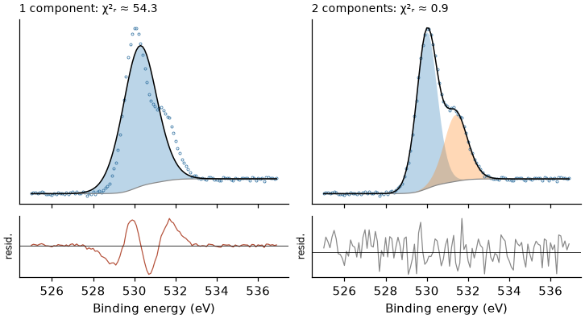

# XPS fitting tutorial for beginners

[中文](零基础XPS拟合教程.md)

This tutorial is for people **fitting XPS spectra for the first time**, from importing data to writing the paper. No
programming is needed.

**Every chapter has three parts**

| Part | Content |
|---|---|
| **Why** | why this step is needed |
| **How** | where to click in PeakForge |
| **Check** | how to tell it was done right |

**Running example**: the two **synthetic** demo files shipped with PeakForge, `examples/demo_fresh.csv` ("before
reaction") and `examples/demo_aged.csv` ("after reaction"), each with C 1s, O 1s, Ir 4f and Ti 2p narrow scans (the
`examples` folder of the installation or of the GitHub repository). They are generated by a program, **not**
measured; the advantage is that we know how they were made and can check whether a fit recovers the truth. Numbers in
the text are actual PeakForge results on these files.

Physics background: [XPS basics](XPS_basics_en.md); every button in detail: [GUI guide](GUI_guide_en.md); what the
program computes: [METHODS](https://github.com/Wiolic/PeakForge/blob/main/docs/METHODS_en.md).

**Contents**

| Part | Chapters |
|---|---|
| I. Preparation | 1 Project and import　2 Look first　3 Charge correction |
| II. Building the model | 4 Fit range and background　5 Line shapes　6 Spin–orbit constraints　7 Number of states and width constraints |
| III. Fitting and judging | 8 Fit　9 Is the fit good?　10 A real trap: the metal tail |
| IV. Results and reporting | 11 Limits of fractions and quantification　12 A series of samples　13 Export and writing it up　14 Common beginner mistakes |

---

## I. Preparation

### 1　Project and import

**Why**　A project is a folder: raw data are kept read-only, and models, results and exports live inside it, so it opens
completely on another computer.

**How**

1. **File → New project…**, choose an empty folder.
2. **File → Import data…**, select `demo_fresh.csv` and `demo_aged.csv`.
3. "Samples & regions" on the left now shows two samples with four regions each. Right-click a sample → **Rename
   sample…** and call them "Fresh" and "Aged" (this name is used in legends).

**Check**　Is each region named correctly (e.g. Ir 4f)? With irregular column headers a region can be misidentified:
right-click it → **Assign element / core level…**; tables with an unusual layout go through **File → Import table with
column mapping…**.

### 2　Look first

**Why**　Look before you fit. In real work start with the **survey**: which elements are present, any unexpected
contamination, any Auger or satellite peak inside the narrow-scan window you will fit. The demo has narrow scans only,
but the checks below still apply.

**How**　Click through the regions on the left. Wheel to zoom, drag to pan, "Reset view" in the toolbar.

**Check** (for every narrow scan)

- Is the peak roughly where this core level should be? A few eV off is usually charging (chapter 3).
- How many clear peaks or shoulders? A shoulder hints at a second chemical state.
- Satellites or loss features on the high-BE side? (The Ir 4f demo has a broad oxide satellite near 66–67 eV.)
- How noisy is it? A noisy spectrum **cannot** support many components.

### 3　Charge correction

**Why**　Insulating samples charge positively and the whole spectrum moves to higher BE. The usual practice sets the
main adventitious-carbon C 1s peak (C–C/C–H) to 284.8 eV and shifts all regions of that sample by the same amount. The
reference itself is uncertain by tenths of an eV and disputed (basics, section 8) [3, 4]; use an internal reference where you
have one.

**How**　**Analysis → Auto charge correction (C 1s)**. The demo gives shifts of about −0.03 eV (almost none needed).
Samples where the automatic search fails are listed; enter the shift with **Analysis → Set charge shift…** (or
right-click the sample).

**Check**

- Shifts within one batch should be similar; an outlier needs a look at its C 1s (lots of C–O, carbide, very weak).
- With hardly any carbon, or when carbon species are what you study, C 1s is not a reliable reference — use an internal
  one.
- State the reference peak and value in the paper.

---

## II. Building the model

### 4　Fit range and background

**Why**　The background represents inelastically scattered electrons (basics, section 9). Its type and end points
change areas, and that uncertainty is **not** in the error bars.

**How**　In the "Peak model" panel on the right:

- **Preset**: choose the preset for the region (e.g. Ir 4f metal/oxide) and click **Apply**; it sets range, background
  and components. Without a suitable preset the program builds a generic model from the orbital table.
- **Background**: type (Shirley / Smart Shirley / Tougaard / linear / none), low and high end (eV). The end points can
  also be set by **dragging the dashed lines** on the plot.
- **Fit range**: the energy interval used in the fit.

What to choose:

| Situation | Suggestion |
|---|---|
| Ordinary narrow scan | **Shirley**. End points where the curve is flat on both sides; the high-BE end a few eV past the last peak (satellites included) |
| Shirley "cuts above the data" between peaks | **Smart Shirley** (background never above the data) |
| Wide window (tens of eV past the peak), more physical | **Tougaard** (universal U2); not in narrow windows |
| Very small step | linear is fine, or as a comparison |

**Check**

- At both ends the background meets the data and does not cross data points under the peaks.
- End points must not sit on another peak or satellite; if another element's peak is in the window, avoid it or add a
  component for it (METHODS section 3, "Limitation").
- Refit with another reasonable background (Shirley ↔ Smart, end points moved by 0.5 eV) and see how much the
  fractions change — that is the background uncertainty you should keep in mind when writing.

### 5　Line shapes

**Why**　Widths come from lifetime (Lorentzian) convolved with instrument, phonons and inhomogeneity (Gaussian); metals
have a tail to higher BE (basics, section 6).

**How**　The "Shape" column of the component table.

| System | Usual shape |
|---|---|
| Oxides, insulators, organics | **GL(30)** (Gaussian–Lorentzian product, 30 % Lorentzian), or SGL, pseudo-Voigt, Voigt |
| Metals (Pt⁰, Au⁰, Ir⁰, Pd⁰ …) | **asymmetric**: DS (Doniach–Šunjić ⊗ Gaussian) or LA |
| Satellites, broad loss features | Gaussian |

**Check**

- A symmetric shape on a metal creates a spurious "oxide" component on the high-BE side — one of the most common
  beginner mistakes.
- The "FWHM" parameter of GL(m) is not the actual full width at half maximum (GL(30) is about 4 % narrower); the
  results table lists "Apparent FWHM" separately — compare that one.
- DS areas depend on the integration cut-off and can only be compared within PeakForge (METHODS section 2).

### 6　Spin–orbit constraints

**Why**　p, d and f levels are doublets; the area ratio follows from 2j+1 (p 1:2, d 2:3, f 3:4), the splitting from
element and level (basics, section 4).

**How**　Tick "Doublet" in the component table; the parameter table then shows `split` and `ratio`. Presets and the
generic model fill them from the orbital table and **fix** the ratio by default.

**Check**

- A ratio or splitting fixed far from the table gives a warning in "Validate project".
- Splittings differ by tenths of an eV between chemical states: in the Ti 2p demo the splitting is free and comes out at
  **5.70 eV** (TiO₂-like), whereas the table value for Ti metal is 6.1 eV [1]. If unsure, free the splitting of one main
  component and let the others follow with the expression `Ti1.split`.
- In 3d transition metals the 2p₁/₂ line is broader (Coster–Kronig); do not force equal widths (basics, section 4).

### 7　Number of states and width constraints

**Why**　**More components always fit "better"** — a smaller residual does not prove that the extra component exists.
Every component needs a **chemical reason** (reference compounds, literature, sample history) [2].

**How**　**Add / Remove** in the component table, or right-click the plot → "Add peak at …". Every parameter has
Value / Min / Max / Vary / Link expr:

| Constraint | Example | Why |
|---|---|---|
| States of one element **share a width** | expression of `Ir4.fwhm`: `Ir3.fwhm` | similar widths in one spectrum under the same conditions; one free parameter fewer |
| Positions relative to each other | `Ir3.center` = `Ir0.center + Ir3.shift` | chemical shifts are more reliable than absolute positions |
| Sensible bounds | FWHM 0.5–2.5 eV | stops one component from becoming very broad and eating the background |

**Check**

- Far fewer free parameters than data points ("Validate project" warns at more than one per 3 points).
- Each width is within the usual range for that kind of state; extremely narrow or broad components rarely mean anything.
- A parameter at a bound (after a fit the status line shows "⚠ n @bounds", hover to see which; also listed in the
  diagnostics warnings and the Excel export) means the constraint, not the data, decides it — ask whether the
  constraint is right or the model is wrong.

---

## III. Fitting and judging

### 8　Fit

**How**　**Analysis → Fit** (F5) or the "Fit" button in the panel. Set "Starts" to 3–12: the program fits from several
random starting points and keeps the best, which avoids local minima. Fit every region with **Analysis → Fit all**
(Shift+F5). Fits run in the background and can be cancelled; if you change the model during a fit, the old result is
discarded with a message.

Result for the "Fresh" Ir 4f of the demo (preset Ir⁰ / Ir³⁺·Ir-OH / Ir⁴⁺ + satellite):

| Component | Centre (eV) | Fraction (%) |
|---|---|---|
| Ir⁰ | 60.85 | 45.4 ± 2.9 |
| Ir³⁺ / Ir-OH | 61.58 | 37.5 ± 2.3 |
| Ir⁴⁺ | 62.37 | 17.1 ± 0.9 |

χ²ᵣ ≈ 1.8, residual RMS 0.41 %. Looks fine — but chapter 10 shows that the Ir⁰ fraction is far less certain than ±2.9 %.

Note that Ir oxide labels are not uniform in the literature (some assign ≈ 61.8 eV to Ir⁴⁺ in IrO₂); the preset note
states this preset's convention; rename labels in the "Label" column if needed.

### 9　Is the fit good?

**Why and check** (in order of importance)

1. **Look at the residual.** In a good fit it scatters randomly around zero like white noise; a systematic wave or
   S shape means a missing component, a wrong position or a wrong line shape.

   

   The figure shows a synthetic O 1s (truly two components): with one component the residual has clear structure and
   χ²ᵣ is in the tens; with two it is noise and χ²ᵣ is about 1.

2. **χ²ᵣ and the noise ratio** (**Analysis → Diagnostics**, F6). χ²ᵣ ≈ 1 means the misfit is at noise level.
   - With a known acquisition time the counting noise is used; otherwise it is estimated from the data, shown with
     "≈", and itself scatters by about ±15–20 %.
   - High-count spectra often give χ²ᵣ ≫ 1 even at RMS < 1 %: the model is statistically incomplete (line shape,
     background) but may be adequate for your question.
   - **A small χ²ᵣ does not mean the model is right** — chapter 10 is a counter-example.
3. **Significance, ΔBIC** (also in "Diagnostics"): each component is removed and the rest refitted. ΔBIC > 10 strong,
   2–10 positive, < 2 not supported by the data (a coarsening of Kass and Raftery [5]). With χ²ᵣ ≫ 1, ΔBIC overstates the evidence for extra components.
4. **Multi-start stability**: if fractions from several random starts scatter by > 3 %, the solution is not unique.
5. **Correlations**: parameter pairs with |r| > 0.95 cannot be separated by the data (typically areas, widths and tail
   parameters of two overlapping components).
6. **Error bars**: ±1σ propagates the data noise only (including the noise of the background end points), **not** the
   choice of background type, end points or line shape (METHODS section 5).

### 10　A real trap: the metal tail

The demo's Ir⁰ was generated with a DS line shape of asymmetry **α = 0.12**. The fit, however, returns **α = 0** (at the
lower bound, listed as `Ir0.alpha @min`). Why?

- The Shirley background is computed from the data **before** the fit and then held fixed. The Ir⁰ tail in the data has
  already been counted as part of the "step" of the background;
- a tail in the model would count it twice, so the fit pushes α to 0 and lets the oxide components make up the shape
  near the peak.

Fixing α at the "true" value is worse:

| Ir⁰ α | χ²ᵣ | Ir⁰ fraction (%) |
|---|---|---|
| free (fitted to 0, at bound) | 1.8 | 45.4 ± 2.9 |
| fixed 0.06 | 3.3 | 34 ± 11 |
| fixed 0.12 (value used to make the data) | 10.1 | 40 ± 10 |

**Lessons**

- In mixed metal–oxide spectra **the metal fraction is very sensitive to the tail parameter and the background**; this
  spectrum alone determines it only to about ±10 %. The ±2.9 % of the free fit is the error *given that α = 0 is right*.
- Errors of parameters at a bound are not meaningful (METHODS section 5).
- In practice: fit a clean metal reference (a sputter-cleaned foil) **on the same instrument, with the same background
  and window rules**, determine α and the other shape parameters, and **fix** them for the samples; report how the
  fractions change under another reasonable choice.

---

## IV. Results and reporting

### 11　Limits of fractions and quantification

**Why**　A "fraction" is the share of each chemical state in the total area of one element (satellites excluded by
default); "Quantification" gives at% = (area/RSF), normalised (basics, section 10).

**How**　**Analysis → Quantification**. The RSF of each region can be edited.

**Check**

- Fraction error bars do not include the choice of background and line shape — the comparison fits of chapters 4 and 10
  often move them more.
- Built-in RSFs lack transmission, IMFP and angular corrections; absolute at% can be off by tens of percent. Enter your
  instrument's RSFs.
- If the sample is not homogeneous over the information depth (oxide film, coating), at% is an apparent value.
- For states with satellites (Cu²⁺, Ir oxides) treat satellites consistently for all components, or the fractions lean
  towards the state whose satellite is "counted in".

### 12　A series of samples

**Why**　When comparing samples, a **consistent model** matters more than the "best" model for each one: the same line
shapes, width rules and background rules, with only what really changes (areas, positions if needed) free.

**How**　Select the finished spectrum (e.g. Fresh Ir 4f), **Analysis → Apply model to others…**, tick the targets and the
parameters to **fix** (usually fwhm and the shape parameters eta / alpha / gamma).

Demo result for Aged Ir 4f: Ir⁰ 6.3 %, Ir³⁺ 66.2 %, Ir⁴⁺ 27.5 % — clearly more oxidised.

**Check**

- With fixed widths, is the residual of the reacted sample still noise? If one sample gets clearly worse, a new state may
  have appeared, or the width really changed (e.g. more disorder).
- The Aged Ti 2p demo has a single component and χ²ᵣ ≈ 3.4, higher than Fresh (≈ 1.9): look at the residual for
  structure before deciding whether a second component (reduced Ti) is needed — and be able to give a chemical reason
  when you add it.

### 13　Export and writing it up

**How**　**Export → Export…** (Ctrl+E): PNG figures, an Excel workbook (parameters, errors, fractions, quantification and
a methods note) and an Origin project. Without originpro, data and a script are written; one command in Origin builds
the project.

**The methods section should state at least** (reviewers and readers need it to reproduce your work):

- instrument, source (monochromated Al Kα etc.), pass energy of narrow scans; whether a flood gun was used;
- charge referencing: reference peak and value (e.g. "C 1s C–C/C–H at 284.8 eV");
- background type and end-point rule;
- line shapes (e.g. GL(30); for metals DS and how its parameters were determined);
- constraints: spin–orbit ratios and splittings, shared widths, fixed parameters;
- software: PeakForge version;
- the limits of fractions and at% (source of the RSFs).

Cross-check key spectra with established programs such as CasaXPS, Avantage or MultiPak.

### 14　Common beginner mistakes

| Mistake | Consequence | Avoid it by |
|---|---|---|
| Too many peaks | smaller residual, meaningless components | a chemical reason for every component; ΔBIC and stability |
| Unconstrained widths | one component becomes very broad and eats the background or others | shared widths within an element, sensible bounds |
| Looking at χ²ᵣ only | residual structure, parameters at bounds, background sensitivity missed | residual first, then diagnostics (chapter 9) |
| Symmetric shape on a metal | a spurious "oxide" | DS / LA with shape parameters from a pure-metal reference (chapter 10) |
| Literature positions without charge correction | wrong assignments | correct first (chapter 3); use chemical shifts, not absolute positions |
| Spin–orbit partners as independent peaks | wrong ratios and splittings, wrong fractions | doublets with fixed ratios (chapter 6) |
| Different backgrounds or models across samples | you compare models, not samples | apply one model to all (chapter 12) |
| Ignoring satellites | biased fractions | separate satellite components, treated consistently (chapter 11) |

---

## References

1. J. F. Moulder, W. F. Stickle, P. E. Sobol, K. D. Bomben, *Handbook of X-ray Photoelectron Spectroscopy*, Perkin-Elmer, 1992.
2. G. H. Major et al., J. Vac. Sci. Technol. A 38 (2020) 061203 (practical guide to XPS peak fitting).
3. D. R. Baer et al., J. Vac. Sci. Technol. A 38 (2020) 031204 (charge neutralisation and BE referencing of insulators).
4. G. Greczynski, L. Hultman, Prog. Mater. Sci. 107 (2020) 100591.
5. R. E. Kass, A. E. Raftery, J. Am. Stat. Assoc. 90 (1995) 773 (BIC criteria).
