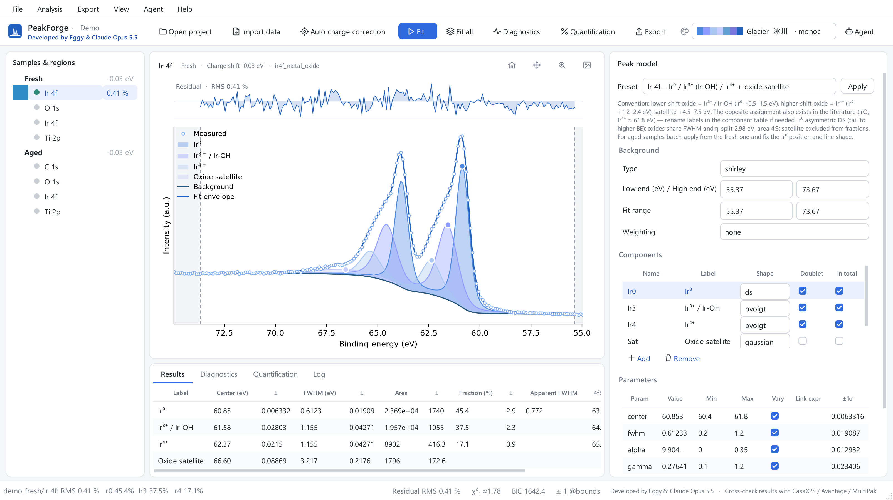
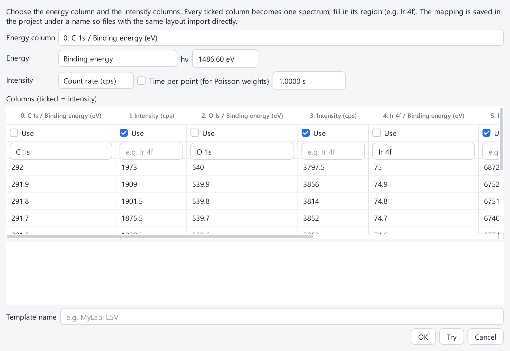
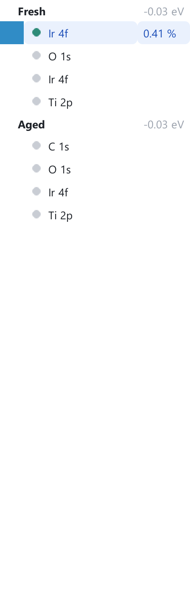
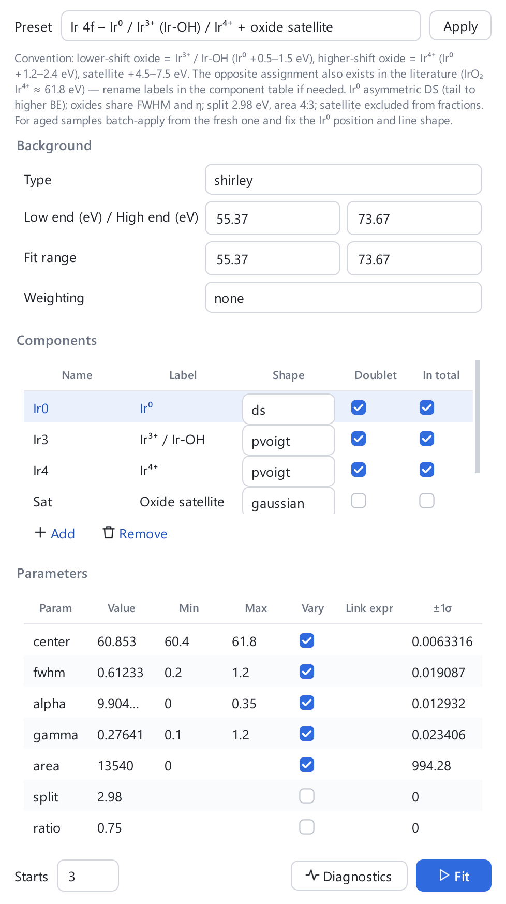
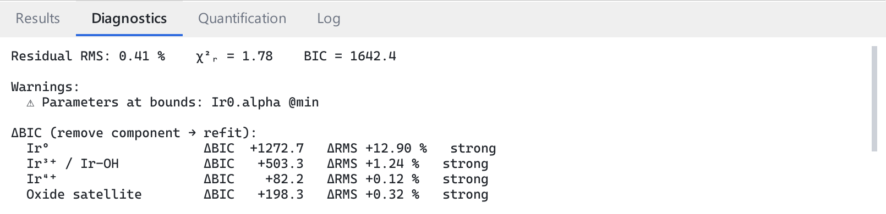
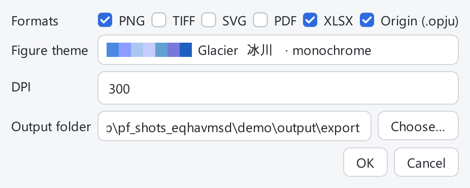
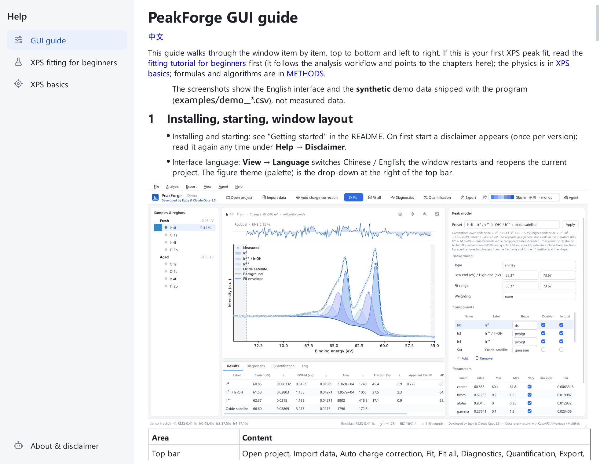

# PeakForge 图形界面使用指南

[English](GUI_guide_en.md)

本指南按界面从上到下、从左到右逐项说明每个按钮。第一次做 XPS 分峰的人请先读 [零基础 XPS 拟合教程](零基础XPS拟合教程.md)（它按
分析流程走一遍，并指向本指南的章节）；物理背景见 [XPS 基础讲义](XPS基础讲义.md)；公式与算法见
[METHODS](https://github.com/Wiolic/PeakForge/blob/main/docs/METHODS.md)。

> 插图中的界面为英文，且数据来自程序自带的**合成**演示数据 `examples/demo_*.csv`，不是实测数据。

## 1　安装与启动、窗口布局

- 安装与启动：见 README 的“上手”。启动后先弹出一次免责声明（每个版本一次）；之后可在 **帮助 → 免责声明** 再次查看。
- 界面语言：**视图 → 语言** 切换中 / 英文，窗口会重启并重新打开当前工程。图形主题（配色）在顶栏右侧的下拉框。

| 区域 | 内容 |
|---|---|
| 顶栏 | 打开工程、导入数据、自动荷电校准、拟合、拟合全部、拟合诊断、元素定量、导出、配色、Agent |
| 左：样品与谱区 | 样品树（章节 4） |
| 中上：谱图 | 测量点、各组分、背景、总拟合与残差（章节 6） |
| 中下：结果 | 四个标签页：结果、诊断、定量、日志 |
| 右：分峰模型 | 预设、背景、组分、参数（章节 7） |
| 状态栏 | 提示、任务进度条与“取消”、χ²ᵣ 与 BIC、署名与免责声明 |

## 2　工程：新建、打开、外部修改

- **文件 → 新建工程…（Ctrl+N）**：选一个文件夹并给名字，生成 `名字.xpsproj` 以及 `data/raw`、`models`、`presets`、`output` 子文件夹。
- **文件 → 打开工程…（Ctrl+O）**、**最近的工程**。工程文件有结构错误时会拒绝打开并指出文件与字段；缺少数据文件只给警告。
- **外部修改自动重载**：工程文件被别的程序（例如 AI Agent，见章节 11）修改后，窗口自动重新载入并在日志里提示。
  如果此时有拟合等后台任务在跑，重载会推迟到任务结束之后。
- **帮助 → 检查工程…**：对整个工程做一次校验，列出错误（会算错或崩溃）与警告（能运行但不规范，例如自由参数过多）。

## 3　导入数据

- **文件 → 导入数据…（Ctrl+I）**：可多选 `.spe`（PHI）、`.vms`（VAMAS）、`.csv/.txt/.dat/.xy`、`.xlsx/.xls`。原始文件会被**复制**到工程的 `data/raw`。
  一个文件里的每个谱区成为样品树中的一行；样品名取文件名。
- **表格自动识别失败**时，会自动打开列映射向导；也可以手动：**文件 → 按列映射导入表格…**。

向导里依次选：能量列；能量是结合能还是动能（动能时填 hν，BE = hν − KE）；强度是 cps 还是 counts，以及每点采集时间（用于泊松权重；counts 没有时间时按 1 s）；
勾选作为强度的列，并在“谱区”一栏填元素与能级（如 `Ir 4f`）。点 **试读** 看结果，起个 **模板名** 后确定。模板存进工程，下次同样格式的文件在导入时直接选这个模板。

## 4　样品树：状态点、能级分配、重命名

- 每个样品一个粗体节点，右边灰字是它的**荷电位移**（eV）；下面是它的各个谱区。
- 谱区前的圆点：**灰** = 还没有模型；**琥珀** = 有模型但未拟合或结果已过期（改过模型）；**绿** = 已拟合。右侧数字是残差 RMS（%）。
- 右键样品或谱区：**指定元素与能级…**（读入时没认出元素/能级时用，如表格数据）、**手动设置荷电位移…**、**重命名样品…**（只改显示名）、**移除样品**。
- 全谱（survey）不参与拟合，不会被自动选中。

## 5　荷电校正

荷电使整张谱平移，需要在做化学态判断前校正。

- **分析 → 自动荷电校准 (C 1s)**：在每个样品的 C 1s 里找主峰，把它移到参考值（默认 284.8 eV，存在工程设置 `charge_ref` 里）。
  峰贴着窗口边缘、没有峰或拟合不收敛时**拒绝校正**，并在日志里列出这个样品和原因（“未自动校准”）——请手动设置。
- **分析 → 手动设置荷电位移…**：对当前样品输入位移（eV）；树中样品名右侧显示当前值。
- 什么时候可信、C 1s 参考的争议见教程第 3 章；校正本身的不确定度见 METHODS。

## 6　谱图区与鼠标操作

右上角四个按钮：复位视图、平移、框选放大、保存图片。滚轮缩放。

| 操作 | 作用 |
|---|---|
| 右键谱图空白处 | 在此处添加一个峰；菜单还有“背景低端/高端设为此处” |
| 拖动峰顶的圆点 | 移动该峰（改峰位） |
| 拖动虚线 | 改背景两端点 |
| 右键某个峰 | 删除该组分 |

上方细条是残差，标题处显示残差 RMS；图例中的名称来自组分的“图例”列。

## 7　分峰模型面板

右侧面板自上而下：

1. **预设**：选一个预设后点 **应用**。“Auto”按当前能级自动选预设，没有则找峰；“通用：自动找峰”适用于任何元素。预设下方的小字是该预设的约定与注意事项。
2. **背景**：类型（Shirley / 线性 / Tougaard / Smart / 无）、低端与高端（eV）、**拟合范围**（拟合所用区间，可比背景端点窄）、**加权**（none = 不加权；poisson = 按计数噪声加权）。
3. **组分**表：名称、图例、**线形**（gaussian、lorentzian、pvoigt、GL、SGL、voigt、DS、LA）、**双峰**（自旋轨道双峰）、**计入占比**（卫星峰通常不勾）。下面 **添加 / 删除**。
4. **参数**表：值、下限、上限、**可变**（取消勾选 = 固定）、**联动表达式**（如 `Ir3.fwhm`，把本参数绑定到别的参数）、±1σ（拟合后的误差）。
   表达式只允许参数引用与数学函数，写错会在保存前被拒绝。
5. **起点数**（多起点拟合的次数）、**拟合**、**拟合诊断**。

编辑与撤销：**分析 → 撤销 / 重做（Ctrl+Z / Ctrl+Y）**；**保存为预设…** 把调好的模型存成自己的预设。模型有错误时不会被保存，会在日志里说明。

## 8　拟合、全部拟合与批量套用

- **分析 → 拟合（F5）**：拟合当前谱区，用面板里的“起点数”。
- **分析 → 拟合全部（Shift+F5）**：对工程里每个有模型的窄谱各拟合一次（用面板里的“起点数”）。
- **分析 → 批量应用当前模型…**：把当前模型套到同一谱区的其他样品上；选目标、选**固定哪些参数**（默认固定 fwhm、alpha、gamma，即“形状沿用，只重新定位置与面积”）、起点数。
- **进度与取消**：任务在后台运行，状态栏出现进度条与 **取消**。取消后**工程保持不变**（已完成的也不写回）。
- **结果被丢弃**：拟合期间你改了该谱的模型、重载了工程或换了工程，结果会被丢弃并在日志提示“…结果已丢弃”，重新拟合即可。
- 某一个谱拟合失败不影响其他谱；失败原因逐条写在日志里。

结果表各列：峰位、FWHM、面积、占比及其 ±1σ；**实测 FWHM**（GL 乘积形式的参数宽度与实测宽度不同，见 METHODS）；双峰的伴峰位置。

## 9　诊断

**分析 → 拟合诊断（F6）**（也可点面板里的按钮）在“诊断”标签页给出：

- 残差 RMS、**χ²ᵣ**（“≈”表示噪声由数据估计）、BIC；
- **警告**：参数撞上下限、噪声比异常（可能是线型失配）、自由参数过多等；
- **ΔBIC**：逐个去掉组分后重拟合，看该组分是否显著；
- **多起点稳定性**：多个起点得到等价解的个数与各占比的散布；
- **相关性** |r| ≥ 0.95 的参数对。

诊断在后台运行，可取消。如何读这些数字见教程第 9 章。

## 10　元素定量与结果标签页

**分析 → 元素定量** 打开“定量”标签页：每个元素的面积、RSF、at%。RSF 一列可直接改成你仪器的值。
**注意**：at% = 面积/RSF 归一，内置 RSF 为近似 Scofield 截面，没有透射函数、非弹性平均自由程与角度校正，绝对值可能偏差数十 %；见教程第 11 章。
“日志”标签页记录所有操作与警告。

## 11　导出与 Agent

**导出 → 导出…（Ctrl+E）**：选格式 PNG / TIFF / SVG / PDF / Excel / Origin（`.opju`）、图形主题、DPI、输出文件夹（默认 `工程/output/export`）。导出在后台运行，完成后打开输出文件夹。
Excel 含各组分参数、拟合质量、定量、曲线数据与免责声明。**没有 Origin/originpro 时**，Origin 项会写出数据和脚本 `build_origin.py`，在 Origin 里运行
`run -pyf build_origin.py` 即可得到工程。图与导出文字一律为英文。

**Agent → 连接 AI Agent（MCP）…**：选数据文件夹，一键写入 `.mcp.json` 与 `AGENTS.md`；在 Claude 桌面版 Code 标签打开该文件夹并允许 “peakforge” 服务器后，
就能用自然语言让 AI 分析当前工程。Agent 的修改会通过章节 2 的外部重载显示在界面上。

## 12　帮助菜单

- **使用指南（F1）**：本窗口——三篇文档（图形界面使用指南、零基础 XPS 拟合、XPS 基础讲义）和“关于与免责声明”。独立窗口，可与主窗口并排；文档按当前界面语言显示。
- **免责声明**、**检查工程…**（章节 2）。
- **导出诊断包…**：生成 zip（日志、版本与环境、工程与模型 JSON；**不含原始数据与谱图数值**），并打开所在文件夹。
- **打开日志文件夹**、**关于**。

## 附录

### A　文件都在哪里

| 位置 | 内容 |
|---|---|
| `工程文件夹/名字.xpsproj` | 工程（JSON）：样品、荷电位移、列模板、设置 |
| `工程文件夹/data/raw` | 导入时复制的原始文件 |
| `工程文件夹/models` | 每个谱区的模型与拟合结果 |
| `工程文件夹/presets` | 你保存的预设 |
| `工程文件夹/output` | 导出结果 |
| `~/.peakforge/settings.json` | 语言、最近工程、免责声明已读标记 |
| `~/.peakforge/peakforge.log` | 滚动日志 |
| 安装目录的 `examples` | 合成演示数据 `demo_fresh.csv`、`demo_aged.csv` |

### B　常见问题

- **导入表格后能量方向不对 / 全是 cps 很小的数**：用列映射向导指定 BE 或 KE、cps 或 counts。
- **“未自动校准”**：该样品 C 1s 找不到可靠的峰，请用“手动设置荷电位移…”。
- **模型“已被拒绝/未载入”**：模型文件有校验错误，按提示重新应用预设或修正；可先用“检查工程…”看全部问题。
- **拟合后结果没出现**：日志里有“结果已丢弃”——拟合期间改动了模型，再拟合一次。
- **参数 `@min` / `@max` 警告**：参数撞了边界，放宽范围或检查模型；演示数据中 Ir⁰ 的 α 撞下限的原因见教程第 10 章。

### C　报错怎么办

弹窗只显示第一行，详情在日志里。请用 **帮助 → 导出诊断包…** 生成 zip 发给开发者（不含原始数据）；并写明做了什么操作。
