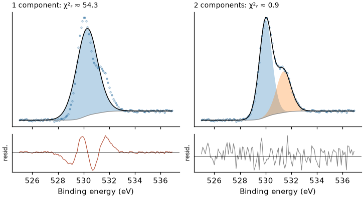

# 零基础 XPS 拟合教程

[English](fitting_tutorial_en.md)

本教程面向**第一次做 XPS 分峰拟合**的人，从导入数据一直讲到写进论文。不需要编程。

**每一章分三段**

| 段落 | 内容 |
|---|---|
| **原理** | 为什么要做这一步 |
| **操作** | 在 PeakForge 里点哪里 |
| **检查** | 怎样判断做对了 |

**贯穿全文的例子**：PeakForge 自带的两份**合成**演示数据 `examples/demo_fresh.csv`（“反应前”）与 `examples/demo_aged.csv`（“反应后”），
各含 C 1s、O 1s、Ir 4f、Ti 2p 四个窄谱（安装目录或 GitHub 仓库的 `examples` 文件夹）。它们是程序生成的，**不是**实测数据；
好处是我们知道它们是怎么生成的，可以检验拟合能不能找回真相。文中的数值来自用 PeakForge 拟合这两份数据的实际结果。

物理背景见 [XPS 基础讲义](XPS基础讲义.md)；每个按钮的细节见 [图形界面使用指南](图形界面使用指南.md)；软件怎么算见
[METHODS](https://github.com/Wiolic/PeakForge/blob/main/docs/METHODS.md)。

**目录**

| 部分 | 章节 |
|---|---|
| 一、准备 | 1 建工程、导入数据　2 先看谱　3 荷电校正 |
| 二、建模型 | 4 拟合范围与背景　5 线型　6 自旋轨道约束　7 化学态个数与宽度约束 |
| 三、拟合与判断 | 8 拟合　9 判断拟合好坏　10 一个真实的陷阱：金属的拖尾 |
| 四、结果与汇报 | 11 占比与定量的局限　12 批量处理一组样品　13 导出与论文写法　14 新手常见错误 |

---

## 一、准备

### 1　建工程、导入数据

**原理**　工程是一个文件夹：原始数据只读保存，模型、结果、导出都放在里面，换电脑也能完整打开。

**操作**

1. 菜单 **文件 → 新建工程…**，选一个空文件夹。
2. **文件 → 导入数据…**，选 `demo_fresh.csv` 和 `demo_aged.csv`。
3. 左侧“样品与谱区”中出现两个样品，各有四个谱区。右键样品 → **重命名样品…**，改成“Fresh”“Aged”（图例里用这个名字）。

**检查**　每个谱区的名称（如 Ir 4f）是否正确。表格文件的列标题不规范时，谱区可能识别错：右键谱区 → **指定元素与能级…** 改正；
格式特殊的表格用 **文件 → 按列映射导入表格…**。

### 2　先看谱

**原理**　拟合之前先用眼睛看。实际工作中应先看**全谱**（survey）：确认有哪些元素、有没有意外的污染元素、有没有俄歇峰或卫星峰落在要拟合的窄谱窗口里。
演示数据只有窄谱，但下面的检查同样适用。

**操作**　在左侧逐个点开谱区。滚轮缩放，拖动平移，工具栏“复位视图”。

**检查**（对每个窄谱问自己）

- 峰的大致位置是否在该能级的合理范围内？差几 eV 通常是荷电（第 3 章）。
- 有几个明显的峰或肩峰？肩峰提示可能有第二个化学态。
- 峰的高 BE 侧有没有卫星峰或损失峰？（Ir 4f 演示数据在约 66–67 eV 有一个宽的氧化态卫星峰。）
- 噪声大不大？噪声大的谱**不能**支撑很多分量。

### 3　荷电校正

**原理**　绝缘样品带正电，整张谱向高 BE 偏移。通常把外来污染碳的 C 1s 主峰（C–C/C–H）设为 284.8 eV，其余谱区按同一位移平移。
这个参考本身有零点几 eV 的不确定度，并有争议（见讲义第 8 节）[3, 4]；有内标时优先用内标。

**操作**　**分析 → 自动荷电校准 (C 1s)**。演示数据得到的位移约 −0.03 eV（几乎不需要校正）。
自动校准失败的样品会被列出，此时用 **分析 → 手动设置荷电位移…**（或右键样品）输入位移。

**检查**

- 同一批样品的位移应大致相近；某个样品差得多，要看它的 C 1s 是否异常（如含大量 C–O、碳化物或很弱）。
- 碳几乎没有、或含碳组分本身是研究对象时，C 1s 参考不可靠——改用内标。
- 论文中写明参考峰与参考值。

---

## 二、建模型

### 4　拟合范围与背景

**原理**　背景代表非弹性散射电子（讲义第 9 节）。背景类型和端点会改变面积，而且这部分不确定度**不在**误差条里。

**操作**　右侧“分峰模型”面板：

- **预设**：选与谱区对应的预设（如 Ir 4f 金属/氧化态）后点 **应用**，会一并设好范围、背景与组分。没有合适预设时，程序按能级表自动建一个通用模型。
- **背景**：类型（Shirley / Smart Shirley / Tougaard / 线性 / 无）、低端与高端（eV）。也可以在谱图上**拖动虚线**改端点。
- **拟合范围**：参与拟合的能量区间。

怎么选：

| 情况 | 建议 |
|---|---|
| 一般窄谱 | **Shirley**。端点放在峰两侧已经平缓的位置，高 BE 端在最后一个峰（含卫星峰）之后几 eV |
| Shirley 在峰间“穿到数据之上” | **Smart Shirley**（背景不超过数据） |
| 窗口很宽（峰后数十 eV）、想更物理 | **Tougaard**（通用 U2）；窄窗口下不要用 |
| 台阶很小 | 线性也可以；或用作对照 |

**检查**

- 背景线在两端与数据重合，不穿过峰底的数据点。
- 端点处不要压着别的峰或卫星峰；窗口里有别的元素的峰时，要么避开，要么加一个分量把它建模（METHODS 第 3 节“局限”）。
- 换一种合理的背景（如 Shirley ↔ Smart、端点各挪 0.5 eV）再拟合一次，看占比变多少——这是背景引起的不确定度，写论文时应心中有数。

### 5　线型

**原理**　峰宽来自寿命（洛伦兹）与仪器、声子、不均匀（高斯）的卷积；金属有朝高 BE 的拖尾（讲义第 6 节）。

**操作**　组分表中的“线形”列。

| 体系 | 常用线型 |
|---|---|
| 氧化物、绝缘体、有机物 | **GL(30)**（高斯–洛伦兹乘积，洛伦兹比例 30 %），或 SGL、pseudo-Voigt、Voigt |
| 金属（Pt⁰、Au⁰、Ir⁰、Pd⁰…） | **不对称**：DS（Doniach–Šunjić ⊗ 高斯）或 LA |
| 卫星峰、宽的损失峰 | 高斯 |

**检查**

- 用对称线型拟合金属，会在高 BE 侧多出一个“假”的氧化态分量——这是新手最常见的错误之一。
- GL(m) 的“FWHM”参数不等于实际半高宽（GL(30) 约窄 4 %），结果表中另列“实测 FWHM”；比较宽度时用实测值。
- DS 的面积依赖积分截断，只能在 PeakForge 内部比较（METHODS 第 2 节）。

### 6　自旋轨道约束

**原理**　p、d、f 能级是双峰，面积比由 2j+1 定（p 1:2、d 2:3、f 3:4），间距（劈裂）由元素与能级定（讲义第 4 节）。

**操作**　组分表“双峰”列打勾后，参数表出现 `split`（间距）与 `ratio`（面积比）。预设与通用模型已按能级表填好，并默认**固定**比例。

**检查**

- 固定的比例或劈裂与能级表差得多时，“检查工程”会给出警告。
- 劈裂在化学态之间会差零点几 eV：演示数据 Ti 2p 中劈裂是自由拟合的，得到 **5.70 eV**（TiO₂ 型），而能级表中金属 Ti 为 6.1 eV [1]。
  不确定时可以让一个主分量的劈裂自由，其余分量用表达式 `Ti1.split` 跟随它。
- 3d 过渡金属的 2p₁/₂ 因 Coster–Kronig 展宽而更宽，不要强行两峰同宽（讲义第 4 节）。

### 7　化学态个数与宽度约束

**原理**　**分量越多，拟合一定越“好”**——残差变小不代表多出来的分量真实存在。每个分量都应该有**化学上的理由**（参考化合物、文献、样品处理历史）[2]。

**操作**　组分表 **添加 / 删除**，或在谱图上右键“在此添加峰”。参数表中每个参数有 值 / 下限 / 上限 / 可变 / 联动表达式：

| 约束 | 例子 | 为什么 |
|---|---|---|
| 同一元素各氧化态**共用宽度** | `Ir4.fwhm` 的表达式填 `Ir3.fwhm` | 同一谱、同一仪器条件下宽度相近，少一个自由参数 |
| 峰位相对固定 | `Ir3.center` = `Ir0.center + Ir3.shift` | 化学位移比绝对峰位更可靠 |
| 合理的上下限 | FWHM 0.5–2.5 eV | 防止一个分量变得极宽，吃掉背景 |

**检查**

- 自由参数个数远少于数据点数（“检查工程”在每 3 个点多于 1 个自由参数时警告）。
- 每个分量的宽度在同类化学态的合理范围内；极窄或极宽的分量通常没有物理意义。
- 参数撞到上下限（拟合后状态栏显示“⚠ n @bounds”，鼠标悬停看是哪些；诊断的警告与 Excel 导出中也会列出），说明约束在起作用而不是数据——要想清楚是约束对，还是模型错。

---

## 三、拟合与判断

### 8　拟合

**操作**　**分析 → 拟合**（F5），或面板上的“拟合”按钮。“起点数”设为 3–12：程序从几个随机起点各拟合一次取最好的，避免掉进局部最小。
所有谱区一起拟合用 **分析 → 拟合全部**（Shift+F5）。拟合在后台运行，可以取消；拟合期间改了模型，旧结果会被丢弃并提示。

演示数据“Fresh”的 Ir 4f（预设 Ir⁰ / Ir³⁺·Ir-OH / Ir⁴⁺ + 卫星峰）拟合结果：

| 分量 | 峰位（eV） | 占比（%） |
|---|---|---|
| Ir⁰ | 60.85 | 45.4 ± 2.9 |
| Ir³⁺ / Ir-OH | 61.58 | 37.5 ± 2.3 |
| Ir⁴⁺ | 62.37 | 17.1 ± 0.9 |

χ²ᵣ ≈ 1.8，残差 RMS 0.41 %。看上去很好——但第 10 章会说明，这里的 Ir⁰ 占比其实远没有 ±2.9 % 这么确定。

注意 Ir 氧化态的标注在文献中不统一（也有把约 61.8 eV 归为 IrO₂ 中 Ir⁴⁺ 的），预设说明里写了本预设的约定；需要时在组分表“图例”列改名。

### 9　判断拟合好坏

**原理与检查**（按重要性排序）

1. **看残差图**。好的拟合，残差像白噪声一样在零附近随机跳动；有系统的“波浪”或“S 形”说明缺分量、峰位不对或线型不对。

   

   上图是一组合成 O 1s（真实为两个分量）：只用一个分量时残差有明显结构，χ²ᵣ 为几十；两个分量时残差是噪声，χ²ᵣ 约 1。

2. **χ²ᵣ 与噪声比**（**分析 → 拟合诊断**，F6）。χ²ᵣ ≈ 1 表示失配在噪声水平。
   - 采集时间已知时用计数噪声；未知时从数据估计，显示为“≈”，本身有约 ±15–20 % 的散布。
   - 计数很高的谱常出现 χ²ᵣ ≫ 1，即使 RMS < 1 %：模型在统计上不完整（线型、背景），但对你的问题可能已经够用。
   - **χ²ᵣ 小不等于模型对**——第 10 章就是反例。
3. **显著性 ΔBIC**（同样在“拟合诊断”里）：逐个去掉分量重新拟合。ΔBIC > 10 强支持，2–10 有支持，< 2 不被数据支持（Kass–Raftery 判据的粗化 [5]）。
   χ²ᵣ ≫ 1 时 ΔBIC 会高估多分量的证据。
4. **多起点稳定性**：多个随机起点得到的占比若散布 > 3 %，说明解不唯一。
5. **参数相关**：|r| > 0.95 的参数对说明数据分不开它们（常见：两个重叠分量的面积、宽度与拖尾参数）。
6. **误差条**：±1σ 只含数据噪声（含背景端点噪声）的传播，**不含**背景类型、端点、线型的选择（METHODS 第 5 节）。

### 10　一个真实的陷阱：金属的拖尾

演示数据的 Ir⁰ 是用不对称参数 **α = 0.12** 的 DS 线型生成的。拟合结果却是 **α = 0**（撞到下限，列为 `Ir0.alpha @min`）。为什么？

- Shirley 背景是**拟合之前**从数据算出来、然后固定的。数据里 Ir⁰ 的拖尾已经被当成“台阶”算进了背景；
- 于是模型里再放一个拖尾就会重复计算，拟合只好把 α 压到 0，并用氧化态分量补足峰附近的形状。

把 α 固定在“真实”值，反而更差：

| Ir⁰ 的 α | χ²ᵣ | Ir⁰ 占比（%） |
|---|---|---|
| 自由（拟合到 0，撞下限） | 1.8 | 45.4 ± 2.9 |
| 固定 0.06 | 3.3 | 34 ± 11 |
| 固定 0.12（生成数据所用值） | 10.1 | 40 ± 10 |

**教训**

- 金属–氧化物混合谱中，**金属占比对拖尾参数和背景非常敏感**，单凭这一张谱只能定到约 ±10 %。自由拟合给出的 ±2.9 % 是“假定 α = 0 正确”时的误差。
- 参数撞到边界时，结果中的误差没有意义（METHODS 第 5 节）。
- 实际做法：在**同一台仪器、同样的背景与窗口规则**下拟合一个干净的金属参考样（溅射清洁的金属箔），定出 α 等线型参数，再在样品中**固定**它们；
  并报告换一种合理设定后占比的变化。

---

## 四、结果与汇报

### 11　占比与定量的局限

**原理**　“占比”是同一元素各化学态面积的比例（卫星峰默认不计入）；“元素定量”的 at% = (面积/RSF) 归一（讲义第 10 节）。

**操作**　**分析 → 元素定量**。可以修改每个谱区的 RSF。

**检查**

- 占比的误差条不含背景与线型选择的影响——第 4、10 章的对照拟合给出的变化往往更大。
- 内置 RSF 未含透射函数、IMFP 与角度校正，绝对 at% 可能偏差数十 %；请填写本仪器的 RSF。
- 样品在信息深度内不均匀（有氧化层、包覆层）时，at% 是表观值。
- 有卫星峰的化学态（如 Cu²⁺、Ir 氧化物），各分量的卫星峰要处理一致，否则占比偏向卫星峰被“算进”的那一方。

### 12　批量处理一组样品

**原理**　比较一组样品时，**模型一致**比每个样品单独“最好”更重要：同样的线型、宽度规则、背景规则，只让真正会变的量（面积，必要时峰位）变化。

**操作**　选中调好的样品（如 Fresh 的 Ir 4f），**分析 → 批量应用当前模型…**，勾选目标谱，选择要**固定**的参数（常用：fwhm、线型参数 eta / alpha / gamma）。

演示数据 Aged 的 Ir 4f 结果：Ir⁰ 6.3 %、Ir³⁺ 66.2 %、Ir⁴⁺ 27.5 %——氧化明显增加。

**检查**

- 固定宽度后，反应后样品的残差是否仍然是噪声？如果某个样品明显变差，可能出现了新的化学态，或宽度确实变了（如无序度增加）。
- 演示数据 Aged 的 Ti 2p 只有一个分量，χ²ᵣ ≈ 3.4，比 Fresh（约 1.9）大：看残差图是否有结构，再决定是否需要第二个分量（低价态 Ti）。
  决定加分量时，要能说出化学上的理由。

### 13　导出与论文写法

**操作**　**导出 → 导出…**（Ctrl+E）：PNG 图、Excel 表（参数、误差、占比、定量及方法说明）、Origin 工程。
没有安装 originpro 时，会生成数据与脚本，在 Origin 中运行一行命令即可。

**论文方法部分至少写明**（审稿人与读者需要它们来复现）：

- 仪器、光源（单色 Al Kα 等）、窄谱通能；中和枪是否使用；
- 荷电校正：参考峰与参考值（如“C 1s C–C/C–H 284.8 eV”）；
- 背景类型与端点规则；
- 线型（如 GL(30)；金属 DS 及其参数如何确定）；
- 约束：自旋轨道比例与劈裂、共用宽度、固定的参数；
- 软件：PeakForge 版本；
- 占比与 at% 的局限（RSF 来源）。

建议把关键谱同时用 CasaXPS / Avantage / MultiPak 等成熟软件复核。

### 14　新手常见错误

| 错误 | 后果 | 怎么避免 |
|---|---|---|
| 峰放得太多 | 残差更小，但分量没有物理意义 | 每个分量要有化学理由；看 ΔBIC 与稳定性 |
| 宽度不约束 | 一个分量变得极宽，吃掉背景或别的分量 | 同元素各态共用宽度，设合理上下限 |
| 只看 χ²ᵣ | 忽略残差结构、参数撞边界、背景敏感性 | 先看残差图，再看诊断（第 9 章） |
| 用对称线型拟合金属 | 多出一个假的“氧化态” | 金属用 DS / LA，并用纯金属参考定线型（第 10 章） |
| 照抄文献峰位、不做荷电校正 | 归属错误 | 先校正（第 3 章），用化学位移而不是绝对峰位 |
| 自旋轨道双峰当成两个独立峰 | 面积比、劈裂不合理，占比错 | 用双峰并固定比例（第 6 章） |
| 不同样品用不同的背景或模型 | 比较的是模型差别而不是样品差别 | 批量应用同一模型（第 12 章） |
| 忽略卫星峰 | 占比偏差 | 卫星峰单独建分量并一致处理（第 11 章） |

---

## 参考文献

1. J. F. Moulder, W. F. Stickle, P. E. Sobol, K. D. Bomben, *Handbook of X-ray Photoelectron Spectroscopy*, Perkin-Elmer, 1992.
2. G. H. Major et al., J. Vac. Sci. Technol. A 38 (2020) 061203（XPS 峰拟合实践指南）。
3. D. R. Baer et al., J. Vac. Sci. Technol. A 38 (2020) 031204（绝缘样品的荷电中和与结合能参考）。
4. G. Greczynski, L. Hultman, Prog. Mater. Sci. 107 (2020) 100591.
5. R. E. Kass, A. E. Raftery, J. Am. Stat. Assoc. 90 (1995) 773（BIC 判据）。
